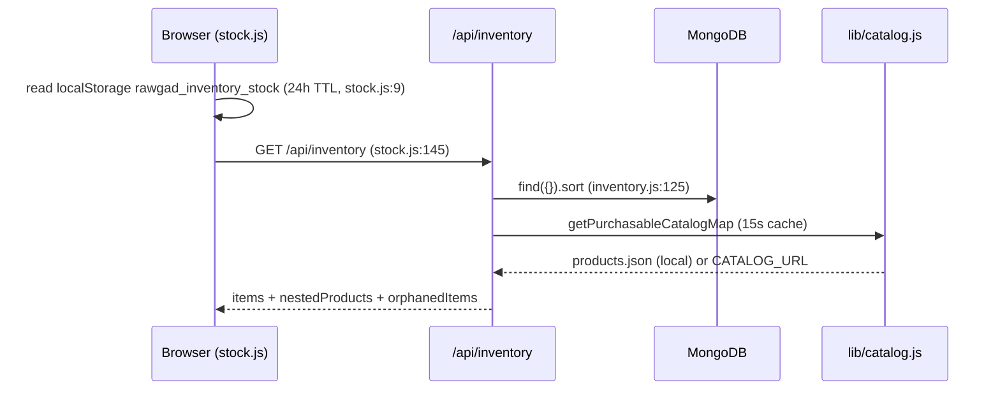
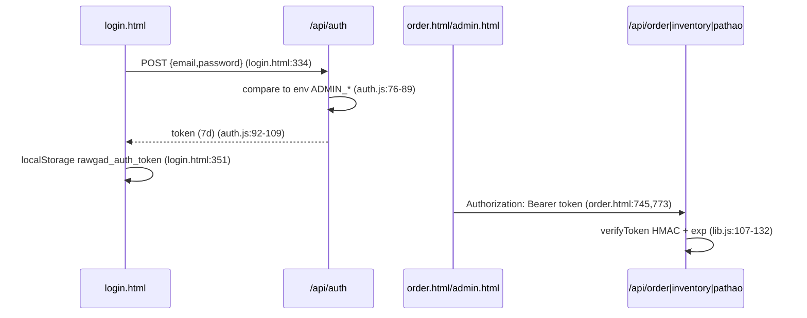
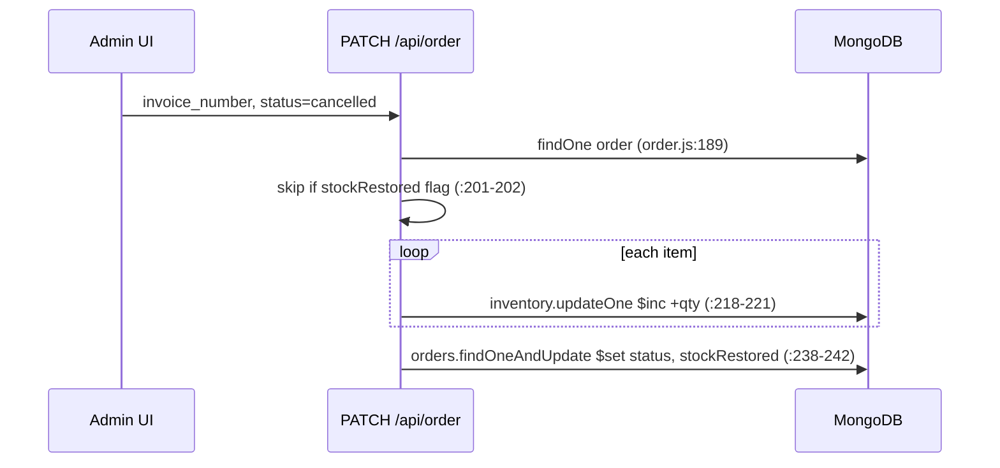

# Data Flows

## 1. Content publish (build time)
```mermaid
sequenceDiagram
  participant E as Editor
  participant P as Pages CMS
  participant G as Git repo
  participant V as Vercel build
  participant S as build-*.js
  E->>P: edit product (schema in .pages.yml)
  P->>G: commit content/product/*.md (author pages-cms[bot])
  G->>V: push triggers deploy (assumed; not verifiable in repo)
  V->>S: npm run build (vercel.json:3)
  S->>S: gray-matter + marked -> JSON, product/*.html, sitemap.xml (package.json:19)
  V-->>V: serve "." as static output (vercel.json:4)
```
Order matters: `build-products.js` runs after index/gadgets/hero; the sitemap runs last so it sees generated pages. Generated files are also committed to git (e.g. `products.json`, `product/`).

## 2. Storefront stock display

Note the unauthenticated path returns the **same payload** as `admin=true` (see review F4).

## 3. Checkout (critical path)
```mermaid
sequenceDiagram
  participant U as checkout.html
  participant K as POST /api/checkout
  participant J as products.json
  participant M as MongoDB
  U->>K: cartItems, cust_*, payment_method, trx_id, coupon_code (checkout.html:1203-1223)
  K->>K: sanitise + validate name/phone/email/address (checkout.js:174-184)
  K->>K: method in cod|bkash|nagad; trx rules (:187-214)
  K->>J: resolveInventoryItem per line (:77-123)
  K->>K: price = catalog price, else client price (:243)
  K->>K: coupon (env or RAWGADZ10/RAWGAD10) (:263-272)
  K->>M: startSession / withTransaction (:329-338)
  loop each line
    K->>M: findOne inventory; reject if isAvailable=false (:341-355)
    K->>M: findOneAndUpdate stock>=qty, $inc -qty (:383-390)
  end
  K->>M: insertOne orders (status pending) (:405)
  K-->>U: invoice_number, redirect_url -> thank.html (:513-528)
  U->>U: clear cart + localStorage stock cache (checkout.html:1239-1242)
```
Failure branches return HTTP 400 with the error message (`:407-418`). The non-transaction fallback (`:422-511`) performs compensation `$inc` on error.

## 4. Admin login and use

Logout is client-only; the server has no revocation (`auth.js:65-67`).

## 5. Inventory mutation
`POST/PATCH /api/inventory` → `requireAdminAuth` (`inventory.js:299`) → read current doc (`:400`) → compute new stock in JS (`:403-493`) → `findOneAndUpdate` with absolute `$set` and `upsert` (`:499-515`). Sync (`:308-379`): fetch fresh catalog, `insertMany` missing keys with `stock:0,isAvailable:false`, count orphans.

## 6. Order cancellation with stock restoration

Restoration errors are caught and logged only (`:232-234`), after which the order is still marked cancelled.

## 7. Courier dispatch and webhook
```mermaid
sequenceDiagram
  participant A as Admin UI (order.html)
  participant P as /api/pathao
  participant PA as Pathao Aladdin
  participant M as MongoDB
  A->>P: POST invoice_number (+overrides), Bearer (order.html:898)
  P->>P: requireAdminAuth (pathao.js:278)
  P->>M: find order; 409 if already dispatched (:297-312)
  P->>PA: POST /aladdin/api/v1/issue-token (cached) (:38)
  P->>PA: POST /aladdin/api/v1/orders (:432)
  P->>M: set consignment_id, courier_status=dispatched, status=shipped (:468-497)
  PA->>P: POST webhook (via /api/pathao-webhook rewrite, vercel.json:19)
  P->>M: courier_status, push courier_events; delivered => status=delivered, verified=true (:102-128)
```
The webhook branch executes **before** auth (`:267-274`) and has no signature/secret check.
