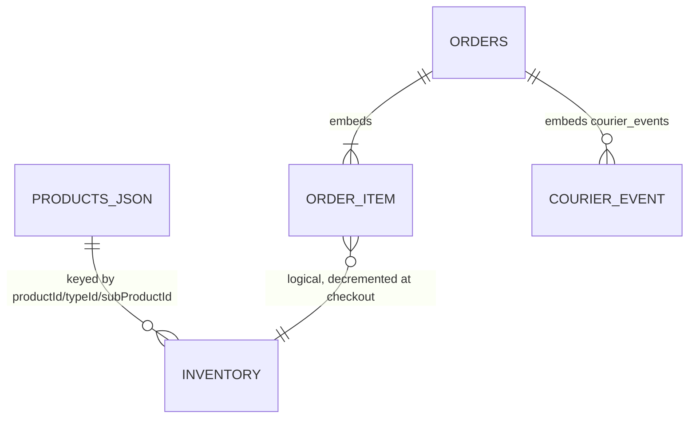

# Database

**Engine:** MongoDB Atlas (driver `mongodb ^6.3.0`). **Database name:** `MONGODB_DB` → `MONGO_DB` → default `paystationdemo` (`lib/db.js:8`). The default name suggests reuse of another project's DB (inference). Connection URI: env `MONGO_URI` (name only).
No ORM, no schema validation (`$jsonSchema`) and **no migration framework** were found. Schemas below are **inferred from code** (not from a live DB; unverified against real data).

## Connection and pooling (`lib/db.js`)
- Singleton cached on `global._mongoClient` and module `clientPromise` (`:79-84`), `maxPoolSize:10`, `serverSelectionTimeoutMS:8000`, `socketTimeoutMS:15000`, `connectTimeoutMS:10000` (`:86-91`), ping on connect (`:96`).
- `ensureIndexes` runs on connect (`:41-70`); failures only `console.warn`.

## Collections

### `inventory`
| Field | Type | Notes |
|---|---|---|
| `_id` | ObjectId | |
| `productId` | string | product `id` from catalog |
| `typeId` | string \| null | type's `subProductId`/`id` |
| `subProductId` | string \| null | |
| `stock` | number | clamped ≥ 0 on read; admin `set` ≥ 0 |
| `isAvailable` | boolean | `true` = "always available" mode: never blocks checkout (`checkout.js:357-373`); `false` = blocked (`:350`). Absent in legacy docs → derived from stock |
| `stockType` | string? | legacy `"available"` honoured in `checkout.js:357` |
| `createdAt`, `updatedAt` | Date | some legacy docs use `updated_at` (`lib/catalog.js:274`) |
| `slug`, `tab` | string? | legacy fallback read in `inventory.js:169-170` |

Index: **unique** compound `{productId:1,typeId:1,subProductId:1}` (`lib/db.js:53-56`). Identity rule: a purchasable item is a product (no types), a type (no subProducts) or a subProduct (`lib/catalog.js:131-139`). `null` ids are stored as real `null`; the string `"null"`/`""` is normalised to null (`normalizeId`, `lib/catalog.js:36`).

### `orders`
Created in `api/checkout.js:281-305`:
```
invoice_number  "INV-" + ObjectId hex upper
subtotal, discount_amount, payment_amount: number ; currency "BDT"
coupon_code: string|null
payment_method: cod|bkash|nagad
status: "pending" (later: shipped, delivered, cancelled, returned, failed, success… free-form strings)
trx_status: cash_on_delivery | under_verification (admin may set any string)
trx_id: "COD-<invoice>" | customer TrxID ; sender_number ; verified: false
customer {name, phone, email, full_address}
items [{id, subProductId, name, price, qty, subtotal}]   // typeId is NOT persisted (checkout.js:295-302)
created_at, updated_at: Date
```
Added later by other modules: `admin_notes`, `courier_status`, `pathao_consignment_id`, `consignment_id`, `pathao_order_status`, `pathao_delivery_fee`, `pathao_dispatched_at`, `courier{provider,status,consignment_id,store_id,amount_to_collect,delivery_fee,dispatched_at,lastWebhookAt}`, `courier_events[]` (raw webhook payloads), `stockRestored`/`stock_restored`, `stockRestoredAt`, `stockRestoredQuantity` (`api/order.js:226-230`, `api/pathao.js:102-118,468-497`). Both snake_case and camelCase timestamps (`updated_at`/`updatedAt`) coexist.

Index: `{invoice_number:1}` **sparse, non-unique** (`lib/db.js:63`).

### Relationships
`orders.items[].id (+subProductId)` → logical reference to `inventory.productId/subProductId` and to `products.json` entries. No foreign keys; since `typeId` is not saved on order items, cancel-restoration must re-resolve identity heuristically (`resolveOrderItemIdentity`, `lib/catalog.js:418-454`; step 4 falls back to the *first* variant of a product).



## Non-database persistence
- Catalog: `products.json` (generated, 46 entries) – source of truth for names/prices.
- Browser: `localStorage` (`main_store_cart`, `rawgad_inventory_stock`, `rawgad_auth_token`, `rawgad_auth_user`).
- In-memory per function instance: catalog (15 s), Pathao token.

## Notable queries
| Query | Location |
|---|---|
| Atomic decrement `{…, stock:{$gte:qty}}` `$inc` | `api/checkout.js:376-390` |
| Orders list with filters, regex search (escaped), limit ≤500 | `api/order.js:51-96` |
| Metrics: loads **all** orders (projection) and aggregates in JS | `api/order.js:99-136` |
| Webhook `$or` on consignment/invoice ids | `api/pathao.js:91-100` |

## Validation
Server-side only for checkout (`checkout.js:133-145,174-229`) and admin stock inputs (`inventory.js:386-493`). Order PATCH takes arbitrary strings for `status`, `trx_status`, `courier_status` without an enum (`order.js:176-180`).

## Migrations / seeding
`seed-inventory.js` and `scratch/migrate-inventory-availability.js` (one-off; not executed here). No versioned migrations.
