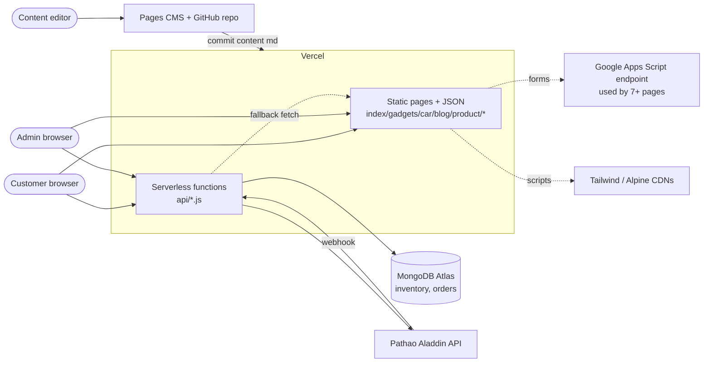
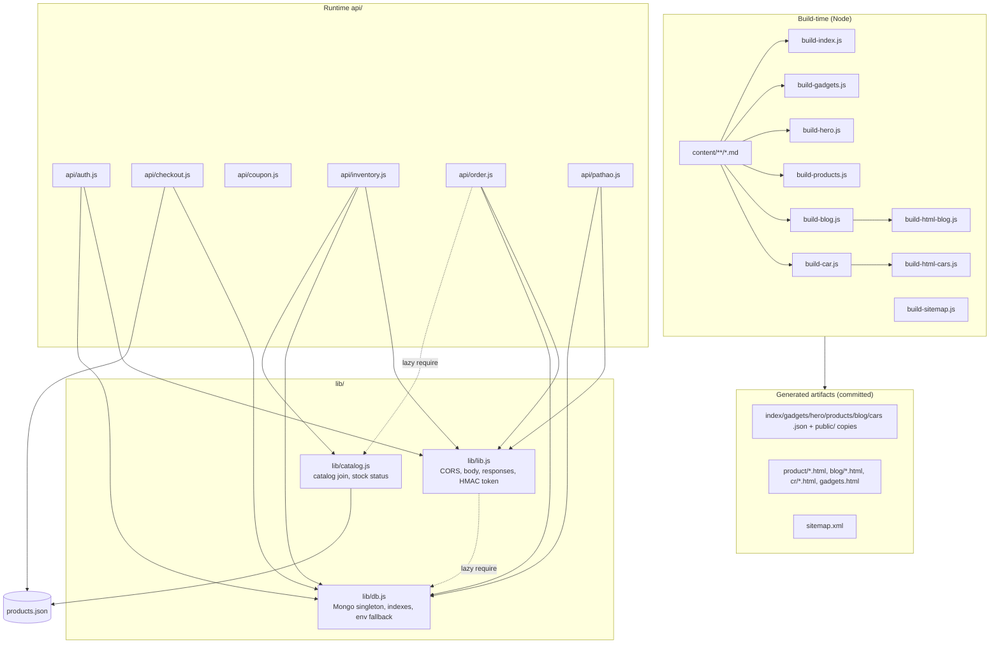

# System Overview

## Architectural style
**Jamstack-style static site with a thin serverless API ("modular monolith of functions") on a document database.** Reasons:

- Build step pre-renders pages from Markdown (`package.json:19`, `build-products.js`, `build-html-blog.js`, `build-html-cars.js`).
- `vercel.json:3-4` runs `npm run build` and serves the repo root (`outputDirectory: "."`).
- Dynamic behaviour is limited to six files in `api/` (Vercel Node functions, `module.exports = async function handler(req,res)`), sharing helpers in `lib/`.
- No server-side sessions, no ORM, no frontend framework/bundler.

It is not microservices: all functions share one database and the same `lib/` modules.

## System context

External references verified: Pathao (`api/pathao.js:26,38`), Apps Script URL (`checkout.html:813`, `thank.html:381`, `contact.html:388`, etc. – payload purpose **unverified**), CDN scripts (`checkout.html:10,13`), remote catalog fallback `CATALOG_URL` (`lib/catalog.js:8`).

## Components and module dependencies

Notes: `api/coupon.js` has no dependencies. `api/checkout.js` does **not** use `lib/lib.js` or `lib/catalog.js`; it re-implements catalog resolution (see review).

## Layer explanation

### Frontend
Plain HTML pages (`index.html`, `gadgets.html`, `car.html`, `blog.html`, `contact.html`, `checkout.html`, `thank.html`, `fail.html`, admin pages). Alpine.js store `cart` persisted in `localStorage` key `main_store_cart` (`checkout.html:750`, `index.html:836`). `stock.js` caches inventory in `localStorage` key `rawgad_inventory_stock` for 24 h (`stock.js:8-9`) and fetches `/api/inventory` (`stock.js:145`). `hero-slider.js` loads `hero.json` (`hero-slider.js:105`). `bd-locations.js` provides Bangladeshi address data for checkout.

### Backend / APIs
See [API-REFERENCE.md](API-REFERENCE.md). Business logic is located in the handlers themselves: price/stock/coupon logic in `api/checkout.js`; stock status rules in `lib/catalog.js:46-55`; order workflow and stock restoration in `api/order.js`; courier mapping in `api/pathao.js`.

### Database
MongoDB Atlas via official driver `mongodb ^6.3.0` (`package.json:24`). See [DATABASE.md](DATABASE.md).

### Authentication / authorization
- **Single admin account** from env (`ADMIN_EMAIL`, `ADMIN_PASSWORD`, `ADMIN_NAME`) compared in plain text (`api/auth.js:76-89`). Login returns a hand-rolled **HS256 JWT-like token** (7-day expiry, `api/auth.js:92-100`; `lib/lib.js:93-132`). Secret from `AUTH_SECRET`.
- Token accepted from `Authorization: Bearer`, `X-Admin-Token`/`X-Auth-Token` headers, or `?token=` query (`lib/lib.js:142-175`).
- Frontend keeps token in `localStorage` key `rawgad_auth_token` (`login.html:351`).
- Authorization is binary (admin or not); `requireAdminAuth` (`lib/lib.js:193`) guards: all of `api/order.js` (`:27`), inventory mutations/delete (`api/inventory.js:299,541`), `GET`/dispatch in `api/pathao.js` (`:156,278`). Customers have no accounts.
- Public: `/api/checkout`, `/api/coupon`, inventory reads, Pathao webhook.

### Integrations
- **Pathao Aladdin**: OAuth password grant with in-memory token cache (`api/pathao.js:20-60`), stores, tracking, order creation, inbound webhook.
- **Pages CMS**: `.pages.yml` defines the product collection schema (path `content/product`) and media.
- **Google Apps Script**: browser `fetch` from several pages. Unverified purpose.

### Configuration
Environment variables (see [DEPLOYMENT.md](DEPLOYMENT.md)); `lib/db.js:10-36` contains a manual `.env` file parser fallback used when `MONGO_URI` is not in the process env.

## Error handling, logging, caching
- Error responses: helpers in `lib/lib.js:42-71` (`{success:false,error}`), but `checkout.js`, `coupon.js`, `auth.js` partly hand-roll responses. `serverError` returns `err.message` to clients (`lib/lib.js:69`).
- Logging: `console.*` only; no structured logging or request IDs.
- Caching: catalog 15 s in-memory (`lib/catalog.js:20`); Pathao token in memory; CDN headers for `/api/inventory` in `vercel.json:33-47`; function-level `Cache-Control` (`api/inventory.js:120-122`); browser 24 h stock cache (`stock.js:9`); MongoDB client reused across warm invocations (`lib/db.js:79`).
- Security headers in `vercel.json:22-31` (nosniff, SAMEORIGIN, deprecated X-XSS-Protection, Referrer-Policy). No CSP/HSTS configured in-repo.
