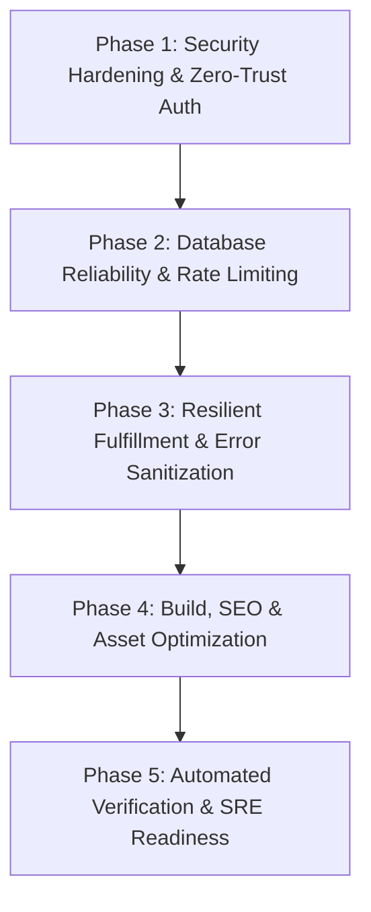

# Production Implementation Plan & Phase Roadmap

**Roadmap Version:** 1.0  
**Target Completion:** Production Go-Live  
**Architect:** Principal Software Architect & DevSecOps Lead  

---

## Phase Overview & Dependency Hierarchy

---

## Phase 1: Security Hardening & Zero-Trust Authentication

### Objectives
Prevent timing attacks, tighten CORS, and eliminate credential brute-force vulnerabilities.

### Tasks
- [ ] **1.1 Constant-Time Token & Signature Verification:**
  - Update [`api/_helpers.js`](file:///C:/Users/victus/Documents/rawgadz_delivery_seo_sec_dev/rawgadz_final/api/_helpers.js) `verifyToken()` to use `crypto.timingSafeEqual()`.
  - Prevent exceptions if buffer lengths mismatch before calling `timingSafeEqual`.
- [ ] **1.2 Strict CORS Origin Restriction:**
  - In `setCors()`, dynamically check request `Origin`.
  - Allow wildcard `*` only for public read requests (`GET /api/inventory`).
  - Restrict `POST /api/checkout`, `api/auth.js`, and `api/order.js` to `process.env.SITE_URL` and `localhost` (in development).
- [ ] **1.3 Constant-Time Pathao Webhook Verification:**
  - In [`api/pathao.js`](file:///C:/Users/victus/Documents/rawgadz_delivery_seo_sec_dev/rawgadz_final/api/pathao.js), compare `x-pathao-secret` with `PATHAO_WEBHOOK_SECRET` using `crypto.timingSafeEqual()`.

### Acceptance Criteria
- Unit tests verify invalid signatures are rejected safely.
- Calling `api/auth.js` or `api/order.js` from unauthorized origins results in blocked CORS preflight.

---

## Phase 2: Database Reliability & Rate Limiting

### Objectives
Protect MongoDB Atlas M0 quota, prevent connection exhaustion, and stop automated spam orders.

### Tasks
- [ ] **2.1 Atlas IP Whitelist & Connection Verification:**
  - Verify that MongoDB Atlas allows connections from dynamic Vercel serverless IPs (`0.0.0.0/0`).
  - Assert `connectToDatabase()` and DB ping execute cleanly without SSL alert 80 errors.
- [ ] **2.2 IP-Based Abuse & Rate Limiting Guard:**
  - Create a lightweight sliding-window rate limiter in `api/_rate-limiter.js`.
  - Apply to `POST /api/checkout`: Maximum 5 orders per 15 minutes per IP.
  - Apply to `POST /api/auth`: Maximum 5 failed login attempts per 10 minutes per IP with exponential lockout.
- [ ] **2.3 Concurrency & Stock Transaction Guard:**
  - Verify atomic stock decrement in `api/checkout.js` using `findOneAndUpdate({ stock: { $gte: qty } })` with retry on transient write conflicts.

### Acceptance Criteria
- Simulated automated spam requests receive `429 Too Many Requests`.
- Real user checkout succeeds with correct stock decrement.

---

## Phase 3: Resilient Fulfillment & Error Sanitization

### Objectives
Ensure order data integrity, seamless Pathao courier dispatch, and zero internal stack-trace leaks.

### Tasks
- [ ] **3.1 Error Sanitization in Production:**
  - In `serverError()` in [`api/_helpers.js`](file:///C:/Users/victus/Documents/rawgadz_delivery_seo_sec_dev/rawgadz_final/api/_helpers.js), hide internal MongoDB and Node.js error stacks when `NODE_ENV === 'production'`.
- [ ] **3.2 Pathao Courier Aladdin Resilience:**
  - Ensure Pathao Aladdin token refreshing handles edge-case expired tokens gracefully.
  - Enforce `$slice: -20` on order `courier_events` array to prevent unconstrained document growth.
- [ ] **3.3 Manual Transaction Verification Workflow:**
  - Validate that orders placed with bKash/Nagad accurately store clean TrxID and phone numbers for admin inspection in `order.html`.

### Acceptance Criteria
- Simulated 500 error returns a safe, clean message to the client.
- Pathao dispatch handles token caching without redundant network calls.

---

## Phase 4: Build Pipeline, SEO & Frontend Optimization

### Objectives
Maximize Core Web Vitals, maintain 100% crawlability, and verify responsive variant image behavior.

### Tasks
- [ ] **4.1 Build Pipeline Validation:**
  - Ensure `npm run build` generates all 46 standalone product pages, category catalogs, and `sitemap.xml` in under 15 seconds.
  - Verify `.vercelignore` ignores `scratch/`, test runners, and private build logs.
- [ ] **4.2 SEO & Structured Data Integrity:**
  - Verify schema.org `Product` JSON-LD markup on all generated product pages.
  - Ensure OpenGraph tags (`og:image`, `og:title`, `og:description`) point to Cloudinary CDN assets.
- [ ] **4.3 Storefront Variant Swatch & Gallery Review:**
  - Verify that variant switching on complex products (`Car Wheel Top Guard...`, `Hanging Gemstones...`) updates the active image and retains thumbnails.

### Acceptance Criteria
- `sitemap.xml` passes validation for all 61+ indexable URLs.
- Lighthouse SEO and Performance scores score >= 90 on mobile and desktop.

---

## Phase 5: Automated Verification & SRE Readiness

### Objectives
Establish end-to-end automated test harness and operational monitoring procedures.

### Tasks
- [ ] **5.1 End-to-End Automated Test Harness:**
  - Maintain [`test-suite.js`](file:///C:/Users/victus/Documents/rawgadz_delivery_seo_sec_dev/rawgadz_final/test-suite.js) as pre-deployment requirement.
  - Include automated checks for:
    1. Database ping
    2. Catalog and variant inventory API response
    3. Build compilation integrity
    4. Client-side stock cache and fallback
    5. Anti-tamper checkout coupon and price calculation
    6. Rate-limiter enforcement
- [ ] **5.2 SRE Health Check & Uptime Monitoring:**
  - Map dedicated `/api/health` lightweight endpoint returning HTTP 200 `{ status: "ok" }`.
- [ ] **5.3 Rollback & Emergency Incident Plan:**
  - Document zero-downtime rollback procedures via Vercel Instant Rollback.

### Acceptance Criteria
- `npm run test` executes all unit and integration checks with zero failures.
- Monitoring endpoint responds with `< 100ms` latency.
