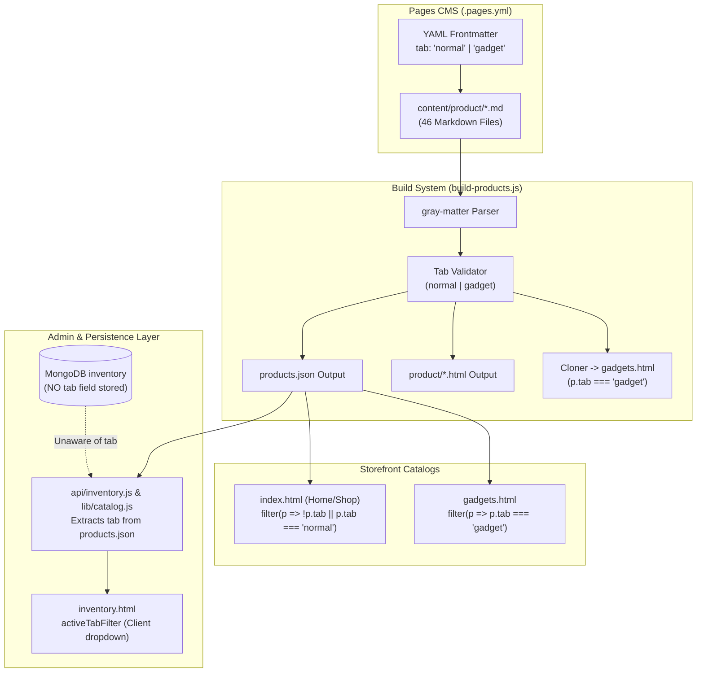
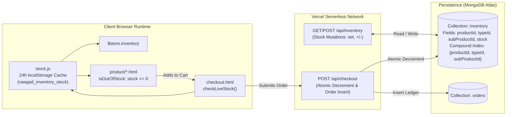
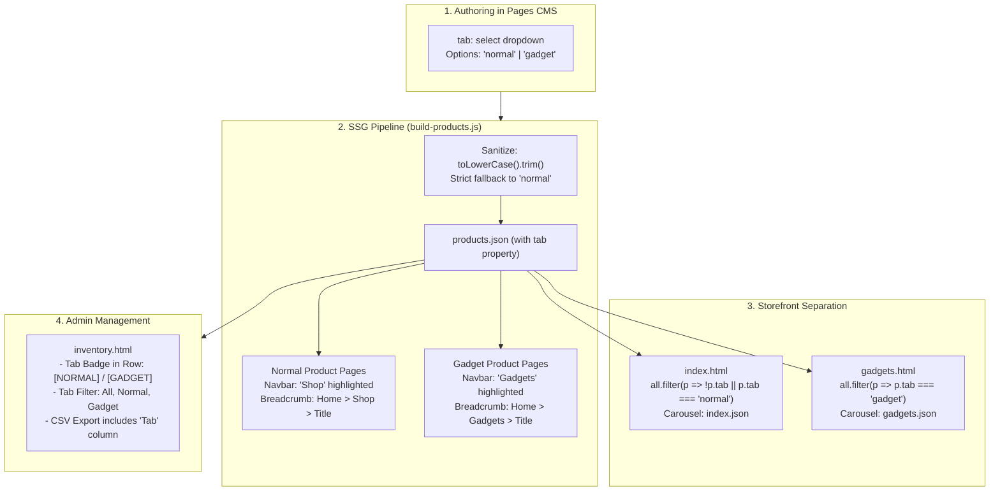
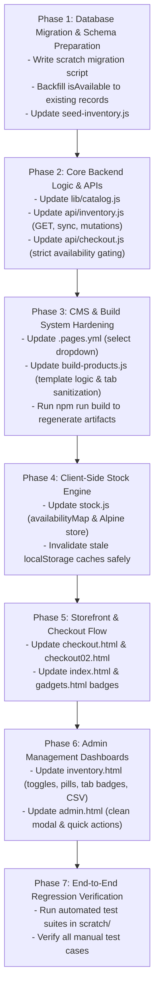

# Investigation & Implementation Plan: Product Separation & Stock Availability

**Document Version:** 1.0.0  
**Project:** Rawgadz E-Commerce Platform (`final_public`)  
**Status:** Investigation Complete & Ready for Implementation  
**Target File:** `plan.md`

---

## 1. Executive Summary & Objectives

This document provides a comprehensive audit and architectural implementation plan for two core business enhancements in the Rawgadz codebase:
1. **Gadget vs. Normal Product Separation:** Ensuring absolute, deterministic isolation between normal catalog products and gadget products across the Git-based CMS (`.pages.yml`), Static Site Generation pipeline (`build-products.js`), frontend interfaces (`index.html`, `gadgets.html`, `product/*.html`), administrative portals (`admin.html`, `inventory.html`), and backend APIs (`api/inventory.js`, `lib/catalog.js`).
2. **True/False Stock Availability Status:** Adding a first-class boolean availability status (`isAvailable`) to the inventory system to govern purchasing permissions independently of numerical stock counts:
   - **`isAvailable: true`**: Always available for purchase across product details, cart, and checkout, regardless of numerical stock count (including zero).
   - **`isAvailable: false`**: Always unavailable for purchase across product details, cart, and checkout, regardless of numerical stock count (even if physical units remain).

Per project instructions, **no application code has been modified during this investigation**. This plan reflects the actual code structure, identifies concrete vulnerabilities, specifies exact changes, defines the implementation order, and provides an end-to-end testing checklist.

---

## 2. Current Implementation Analysis

### 2.1 Product Classification Architecture (Normal vs. Gadget)



1. **Content Definition (`content/product/*.md`):**
   - Products are authored as markdown documents with YAML frontmatter.
   - Classification is defined by the `tab` key:
     - `tab: normal` for standard catalog products (e.g. steering covers, interior accessories).
     - `tab: gadget` for gadget products (e.g. `prod_002.md` Studio ANC Headphones, `prod_003.md` Retro Instant Camera).
   - **Current Count:** Exactly 46 product markdown files exist in `content/product/`:
     - **44 Normal Products** (`tab: normal` or omitted)
     - **2 Gadget Products** (`tab: gadget`: `prod_002.md`, `prod_003.md`)
2. **Carousel Slides vs. Product Documents:**
   - `content/index/*.md` and `content/gadgets/*.md` are **carousel category slides** compiled by `build-index.js` and `build-gadgets.js` into `index.json` and `gadgets.json` respectively. They are not purchasable product definitions.
3. **Build Pipeline (`build-products.js`):**
   - Reads `content/product/*.md`.
   - Validates frontmatter `tab` (defaults to `'normal'` if omitted; strictly throws an error if not `'normal'` or `'gadget'`).
   - Generates `products.json` and `public/products.json` containing the entire catalog.
   - Generates standalone product pages in `product/${slug}.html`.
   - Generates `gadgets.html` by cloning `index.html` and substituting the filtering string:
     `all.filter(p => !p.tab || p.tab === 'normal')` $\rightarrow$ `all.filter(p => p.tab === 'gadget')`.
4. **Storefront Frontend (`index.html` & `gadgets.html`):**
   - Both pages fetch `products.json` asynchronously upon initialization.
   - `index.html` filters: `this.allProducts = all.filter(p => !p.tab || p.tab === 'normal');`.
   - `gadgets.html` filters: `this.allProducts = all.filter(p => p.tab === 'gadget');`.
   - Category tag filters and text search filter within `this.allProducts`, preventing cross-tab leakage.
5. **Backend Catalog & APIs (`lib/catalog.js` & `api/inventory.js`):**
   - `lib/catalog.js` extracts `tab: String(product.tab || "").trim()` during `extractPurchasableItems` and `buildNestedCatalog`.
   - `api/inventory.js` attaches `tab` to returned items when `catalogInfo` is present.
6. **Admin Panel (`inventory.html` & `admin.html`):**
   - `inventory.html` dynamically calculates `availableTabs` from loaded items and provides an `activeTabFilter` dropdown (`All Tabs`, `NORMAL`, `GADGET`).
   - `admin.html` does not expose or filter by `tab`.

---

### 2.2 Existing Numerical Stock System



1. **Database Schema (`MongoDB: inventory collection`):**
   - Authoritative identity: 3-part compound tuple `(productId, typeId, subProductId)` with unique compound index `{ productId: 1, typeId: 1, subProductId: 1 }`.
   - Current fields:
     - `productId` (`String`)
     - `typeId` (`String | null`)
     - `subProductId` (`String | null`)
     - `stock` (`Int32` non-negative integer)
     - `createdAt` (`Date`)
     - `updatedAt` (`Date`)
   - **Crucial Finding:** The database currently stores **only** numerical `stock`. There is **no persistent boolean field** for stock availability.
2. **Dynamic Stock Status Computation:**
   - `lib/catalog.js` classifies stock using `getStockStatus(stock)`:
     - `stock <= 0` $\rightarrow$ `"out_of_stock"`
     - `stock <= 5` $\rightarrow$ `"low_stock"`
     - `stock > 5` $\rightarrow$ `"in_stock"`
   - `api/inventory.js` computes `isAvailable` dynamically on the fly:
     `isAvailable: stock > 0`
3. **Client-Side Stock Cache (`stock.js`):**
   - Caches the full inventory array in `localStorage` under `rawgad_inventory_stock` with a 24-hour TTL (`CACHE_TTL_MS = 86400000`).
   - Builds a lookup dictionary (`stockMap`) mapping composite keys (`productId:::typeId:::subProductId`, `typeId:::subProductId`, etc.) to numerical stock values.
   - Line 54-55 in `stock.js`:
     ```javascript
     const isAvail = item.isAvailable === true || item.stockType === 'available';
     const stock = typeof item.stock === 'number' ? Math.max(0, item.stock) : (isAvail ? 999 : 0);
     ```
     Because `item.stock` in MongoDB/API is always a number (default 0 or seeded 10), `typeof item.stock === 'number'` is always true, causing `isAvail` to be completely bypassed.
4. **Standalone Product Page Purchase Gate (`build-products.js`):**
   - Line 804:
     ```javascript
     get isOutOfStock() {
       return !this.loadingInventory && (typeof this.currentStock !== 'number' || this.currentStock <= 0);
     }
     ```
   - Line 870: `if (newQty > 0 && typeof this.currentStock === 'number' && newQty > this.currentStock)` alerts that only `currentStock` items are available.
   - Line 906: `buyNow()` immediately aborts if `isOutOfStock` is true.
5. **Checkout & Order Processing (`api/checkout.js`):**
   - Lines 350-394 & 427-466:
     ```javascript
     const isAlwaysAvailable = existingDoc && (existingDoc.isAvailable === true || existingDoc.stockType === "available");
     if (isAlwaysAvailable) {
       // Decrements stock if stock >= qty, else leaves stock as is and proceeds
     } else {
       // Fixed stock mode: requires stock >= item.qty, otherwise throws INSUFFICIENT_STOCK
     }
     ```
   - If `existingDoc.isAvailable` is `false` (or missing), it falls into the `else` block, which checks `stock: { $gte: item.qty }`. **If numerical stock is > 0, it allows the purchase even when `isAvailable` is intended to be false.**

---

## 3. Confirmed Issues & Root Cause Analysis

### 3.1 Issues in Gadget vs. Normal Product Separation

| ID | Issue Description | Location | Root Cause | Business Impact |
| :--- | :--- | :--- | :--- | :--- |
| **ISSUE-1.1** | Freeform text `tab` field in CMS configuration | [`.pages.yml#L24-L30`](file:///C:/Users/victus/Documents/Rawgadz_05/final_public/.pages.yml#L24-L30) | `type: string` allows content editors to enter arbitrary text (e.g. "Gadget", "gadgets", "Normal", "accessories") | If an invalid string is entered, [`build-products.js#L952`](file:///C:/Users/victus/Documents/Rawgadz_05/final_public/build-products.js#L952) throws a fatal error, breaking production static site generation (`npm run build`). |
| **ISSUE-1.2** | No `tab` persistence in MongoDB inventory collection | [`seed-inventory.js#L68-L130`](file:///C:/Users/victus/Documents/Rawgadz_05/final_public/seed-inventory.js#L68-L130), [`api/inventory.js#L320-L330`](file:///C:/Users/victus/Documents/Rawgadz_05/final_public/api/inventory.js#L320-L330) | The `inventory` documents store only `{ productId, typeId, subProductId, stock }`. `tab` is merged at runtime from `products.json`. | Orphaned items or database-only items lose their category classification. The database cannot query or filter inventory by tab. |
| **ISSUE-1.3** | Table rows in Admin UI omit visual `tab` badge | [`inventory.html#L335-L351`](file:///C:/Users/victus/Documents/Rawgadz_05/final_public/inventory.html#L335-L351) | Table columns show Product Name, Type Name, Subproduct, Price, Stock, Status, Updated, but no Tab pill. | Admins cannot tell at a glance whether an item is a Normal Product or Gadget without using the dropdown filter. |
| **ISSUE-1.4** | CSV export omits `Tab` column | [`inventory.html#L1008-L1020`](file:///C:/Users/victus/Documents/Rawgadz_05/final_public/inventory.html#L1008-L1020) | CSV header array is `['ProductId', 'TypeId', 'SubProductId', 'ProductTitle', 'TypeTitle', 'SubTitle', 'Price', 'Stock', 'Status', 'UpdatedAt']`. | Exported spreadsheets lack classification data, hindering inventory audits. |
| **ISSUE-1.5** | Standalone Gadget pages link "Shop" back to `#shop` | [`build-products.js#L147`](file:///C:/Users/victus/Documents/Rawgadz_05/final_public/build-products.js#L147) | Standalone product navbar hardcodes `<a href="../index.html#shop">Shop</a>`. | A customer browsing a gadget who clicks "Shop" lands on `index.html#shop`, where gadgets are excluded, creating confusion. |

---

### 3.2 Issues in Stock Availability Logic

| ID | Issue Description | Location | Root Cause | Business Impact |
| :--- | :--- | :--- | :--- | :--- |
| **ISSUE-2.1** | No persistent boolean availability field in MongoDB | [`api/inventory.js#L457-L472`](file:///C:/Users/victus/Documents/Rawgadz_05/final_public/api/inventory.js#L457-L472) | Mutations (`set`, `increase`, `decrease`, `adjust`) only update `stock: Int32`. `isAvailable` is computed on the fly as `stock > 0`. | Cannot set an item as "Available" with 0 stock, or "Unavailable" with > 0 stock. |
| **ISSUE-2.2** | Legacy "Available" button in Admin is a numerical hack | [`admin.html#L641`](file:///C:/Users/victus/Documents/Rawgadz_05/final_public/admin.html#L641), [`api/inventory.js#L440`](file:///C:/Users/victus/Documents/Rawgadz_05/final_public/api/inventory.js#L440) | Clicking "Stock Available" sets numerical stock to `999` (or `100`). | Distorts true physical warehouse counts and still treats items as out-of-stock if units drop to 0. |
| **ISSUE-2.3** | `stock.js` client cache overrides `isAvailable` when stock is 0 | [`stock.js#L54-L55`](file:///C:/Users/victus/Documents/Rawgadz_05/final_public/stock.js#L54-L55) | `typeof item.stock === 'number' ? Math.max(0, item.stock) : (isAvail ? 999 : 0)` evaluates to `0` when `stock: 0`. | Client cache marks the item as 0 stock, overriding any availability flag sent by the API. |
| **ISSUE-2.4** | Product pages block purchase when `stock: 0` despite availability | [`build-products.js#L804`](file:///C:/Users/victus/Documents/Rawgadz_05/final_public/build-products.js#L804), [`#L870`](file:///C:/Users/victus/Documents/Rawgadz_05/final_public/build-products.js#L870) | `isOutOfStock` checks `currentStock <= 0`, and `updateCart` checks `newQty > currentStock`. | Customer cannot add item to cart or click "Buy Now" when stock is 0, even if the item is configured as always available. |
| **ISSUE-2.5** | `checkout.js` allows purchase when `isAvailable: false` if stock > 0 | [`api/checkout.js#L368-L384`](file:///C:/Users/victus/Documents/Rawgadz_05/final_public/api/checkout.js#L368-L384), [`#L441-L457`](file:///C:/Users/victus/Documents/Rawgadz_05/final_public/api/checkout.js#L441-L457) | When `isAvailable` is false, code defaults to fixed stock check `stock >= qty`. | Items intended to be unavailable can still be bought if warehouse stock is > 0. |
| **ISSUE-2.6** | Admin Inventory UI lacks True/False availability controls | [`inventory.html#L384-L435`](file:///C:/Users/victus/Documents/Rawgadz_05/final_public/inventory.html#L384-L435) | `inventory.html` only provides numerical increment/decrement and a "Set Stock Value" prompt. | Admins cannot toggle True/False availability directly from the inventory management table. |
| **ISSUE-2.7** | Checkout UI falsely displays "Out of stock in database" when stock is 0 | [`checkout.html#L612-L614`](file:///C:/Users/victus/Documents/Rawgadz_05/final_public/checkout.html#L612-L614) | Checks `getItemStock(item) <= 0` without evaluating `isAvailable`. | Confuses customers by claiming an item is out of stock when it is configured to be always available. |

---

## 4. Proposed Architecture & Solutions

### 4.1 Separation Rules: Normal Products vs. Gadgets



1. **Pages CMS Restriction ([`.pages.yml`](file:///C:/Users/victus/Documents/Rawgadz_05/final_public/.pages.yml)):**
   - Replace `type: string` with `type: select`:
     ```yaml
     - name: tab
       type: select
       label: Product Classification
       required: false
       default: normal
       options:
         - normal
         - gadget
       description: "Select product category: 'normal' for Home & Shop, 'gadget' for Gadgets catalog."
     ```
   - This eliminates human error and typo-induced build failures.
2. **Build System Normalization ([`build-products.js`](file:///C:/Users/victus/Documents/Rawgadz_05/final_public/build-products.js)):**
   - Ensure case-insensitive normalization:
     ```javascript
     let tab = 'normal';
     if (data.tab !== undefined && data.tab !== null) {
       const rawTab = String(data.tab).trim().toLowerCase();
       tab = (rawTab === 'gadget') ? 'gadget' : 'normal';
     }
     ```
   - In standalone pages, if `product.tab === 'gadget'`, highlight the "Gadgets" navbar item and provide breadcrumb navigation pointing back to `../gadgets.html`. If `product.tab === 'normal'`, highlight "Shop" and link to `../index.html#shop`.
3. **Admin UI Enrichment ([`inventory.html`](file:///C:/Users/victus/Documents/Rawgadz_05/final_public/inventory.html)):**
   - Render a distinct badge in the table row:
     - `<span class="bg-blue-50 text-blue-700 border border-blue-200 text-[9px] font-bold uppercase px-1.5 py-0.5 rounded">Gadget</span>` when `item.tab === 'gadget'`.
     - `<span class="bg-neutral-100 text-neutral-600 border border-neutral-200 text-[9px] font-bold uppercase px-1.5 py-0.5 rounded">Normal</span>` when `item.tab === 'normal'`.
   - Update `exportCSV()` to include `Tab` as a dedicated column in the exported spreadsheet.
   - Add tab distribution count to the summary header (e.g. `Normal: 44`, `Gadgets: 2`).
4. **Backend API Filtering ([`api/inventory.js`](file:///C:/Users/victus/Documents/Rawgadz_05/final_public/api/inventory.js)):**
   - Support optional `?tab=normal` or `?tab=gadget` query parameter in `GET /api/inventory` to allow consumers to request a filtered inventory list.

---

### 4.2 Stock Availability Logic: True/False Binary Specification

The new stock system establishes **`isAvailable` as the primary gatekeeper for purchasing**, while preserving numerical `stock` for warehouse quantity tracking.

```mermaid
flowchart TD
    StartCheck["Customer Attempts Purchase / Views Item"] --> ReadAvailability{"Evaluate isAvailable Status"}

    ReadAvailability -->|isAvailable === false| Blocked["ALWAYS UNAVAILABLE\n(Regardless of numerical stock count)"]
    Blocked --> BadgeUnavailable["Badge: 'Unavailable' / 'Out of Stock' (Rose)"]
    Blocked --> DisableButtons["Disable 'Add to Cart' & 'Buy Now'"]
    Blocked --> CartWarning["Cart / Checkout shows 'Item Unavailable'"]
    Blocked --> APIReject["api/checkout REJECTS order with HTTP 400\n('Item is currently unavailable')"]

    ReadAvailability -->|isAvailable === true| Allowed["ALWAYS AVAILABLE\n(Regardless of numerical stock count, including 0)"]
    Allowed --> BadgeAvailable["Badge: 'Available' / 'In Stock' (Emerald)"]
    Allowed --> EnableButtons["Enable 'Add to Cart' & 'Buy Now'"]
    Allowed --> CheckoutAllowed["Checkout Proceeds Successfully"]
    
    CheckoutAllowed --> StockCheck{"Warehouse Stock Count?"}
    StockCheck -->|stock >= qty| DecrementStock["Decrement numerical stock\n($inc: { stock: -qty })"]
    StockCheck -->|stock < qty (including 0)| PreserveStock["Keep stock as is (floor at 0)\nOrder placed successfully"]
```

#### Detailed Availability Specification Rules:

1. **`isAvailable: true` (Always Available):**
   - **Storefront & Details Page:** The item is marked "In Stock" / "Available". "Add to Cart" and "Buy Now" are enabled. Quantity selection is permitted regardless of numerical stock (even if `stock === 0`).
   - **Cart Drawer & Checkout:** The item is valid for checkout. No "Out of stock in database" error is rendered.
   - **Checkout Execution (`api/checkout.js`):**
     - Order processing **never blocks**.
     - If physical warehouse units exist (`stock >= qty`), numerical stock is decremented atomically (`$inc: { stock: -qty }`) to track physical inventory depletion.
     - If physical units are zero or insufficient (`stock < qty`), the order proceeds without error and stock remains at its floor (`0`).
2. **`isAvailable: false` (Always Unavailable):**
   - **Storefront & Details Page:** The item is marked "Unavailable" / "Out of Stock". "Add to Cart" and "Buy Now" are strictly disabled.
   - **Cart Drawer:** If an item in the cart is marked unavailable, an alert banner is displayed and quantity incrementing is disabled.
   - **Checkout UI (`checkout.html`):** Renders a prominent "Item Currently Unavailable" error banner and disables the "Complete Order" button.
   - **Checkout Execution (`api/checkout.js`):**
     - Atomically checks `isAvailable`. If `false`, the checkout is **strictly rejected** with HTTP 400:
       `{ "success": false, "error": "Item \"[Item Name]\" is currently unavailable for purchase." }`.
     - **This applies even if numerical stock is 100.** Physical inventory count cannot override `isAvailable: false`.
3. **Backward Compatibility Fallback:**
   - For legacy database records where `isAvailable` is `undefined` or `null`:
     ```javascript
     const effectiveAvailable = (typeof doc.isAvailable === 'boolean')
       ? doc.isAvailable
       : ((typeof doc.stock === 'number') ? doc.stock > 0 : false);
     ```
   - This ensures zero downtime and seamless operation during deployment before migration scripts complete.

---

### 4.3 Client Caching & Synchronisation Model (`stock.js`)

To guarantee immediate rendering without edge latency, `stock.js` will store both numerical stock and boolean availability in the precomputed cache:

```javascript
// Structure of cached item in localStorage (rawgad_inventory_stock)
{
  "timestamp": 1728924000000,
  "inventory": [
    {
      "productId": "prod_001",
      "typeId": "type_black",
      "subProductId": "strap_leather",
      "stock": 15,
      "isAvailable": true,
      "status": "in_stock"
    }
  ],
  "stockMap": {
    "prod_001:::type_black:::strap_leather": 15
  },
  "availabilityMap": {
    "prod_001:::type_black:::strap_leather": true
  }
}
```

- Expose `isItemAvailable(productId, typeId, subProductId)` on `window.RawgadStock` and Alpine `$store.inventory`.
- Update `getItemStock(productId, typeId, subProductId)` to continue returning numerical stock for display.

---

### 4.4 Admin Panel Availability Controls (`inventory.html` & `admin.html`)

1. **Table Column & Interactive Switch ([`inventory.html`](file:///C:/Users/victus/Documents/Rawgadz_05/final_public/inventory.html)):**
   - Add an **Availability** column with an interactive 1-click toggle button:
     - **Active (True):** Green toggle pill `[✓ Available]`.
     - **Inactive (False):** Red/Gray toggle pill `[✕ Unavailable]`.
   - Clicking the toggle immediately issues `POST /api/inventory` with `{ action: 'set_availability', isAvailable: boolean }` and updates the reactive table row.
2. **Bulk Actions:**
   - Add **"Make Available (True)"** and **"Make Unavailable (False)"** buttons to the bulk action bar when items are selected via checkboxes.
3. **Filter Pills:**
   - Add status filter pills:
     - `All Items`
     - `Available (True)`
     - `Unavailable (False)`
     - `In Stock (>5)`
     - `Low Stock (1-5)`
     - `Out of Stock (0)`
4. **Operations Hub Modal ([`admin.html`](file:///C:/Users/victus/Documents/Rawgadz_05/final_public/admin.html)):**
   - Update "Add or Update Inventory" modal:
     - True/False Availability Toggle: `[ Available for Purchase: YES / NO ]`.
     - Numerical Stock Input: Exact integer count.
     - Saves both values explicitly to MongoDB without 999 stock hacks.

---

## 5. Affected Components & Files Matrix

| File Path | Component Role | Required Changes | Impact & Risk |
| :--- | :--- | :--- | :---: |
| [`.pages.yml`](file:///C:/Users/victus/Documents/Rawgadz_05/final_public/.pages.yml) | Headless CMS Configuration | Change `tab` field from `type: string` to `type: select` with options `['normal', 'gadget']`. | Low |
| [`build-products.js`](file:///C:/Users/victus/Documents/Rawgadz_05/final_public/build-products.js) | Static Site Generator & Standalone HTML Template | 1. Sanitize `tab` with safe fallback.<br>2. Update standalone template purchase logic: check `isAvailable` instead of `stock <= 0` in `isOutOfStock` and `updateCart`.<br>3. Contextualize breadcrumbs/navbar for gadget pages (`gadgets.html` vs `index.html#shop`). | Medium |
| [`lib/catalog.js`](file:///C:/Users/victus/Documents/Rawgadz_05/final_public/lib/catalog.js) | Catalog Authority & Hierarchy Resolver | 1. Update `getStockStatus(stock, isAvailable)` to factor in `isAvailable`.<br>2. Propagate `isAvailable` in `buildNestedCatalog` and `extractPurchasableItems`. | Low |
| [`lib/db.js`](file:///C:/Users/victus/Documents/Rawgadz_05/final_public/lib/db.js) | MongoDB Atlas Singleton & Index Assurance | Ensure index `{ productId: 1, typeId: 1, subProductId: 1 }` and add index `{ isAvailable: 1 }` if needed for query acceleration. | Low |
| [`api/inventory.js`](file:///C:/Users/victus/Documents/Rawgadz_05/final_public/api/inventory.js) | Inventory Management & Storefront API | 1. Return stored `isAvailable: Boolean` in all GET routes.<br>2. Support `?tab=normal` and `?tab=gadget` query filtering.<br>3. In `sync`, insert missing items with `isAvailable: false`.<br>4. In mutations, support `set_availability`, `toggle_availability`, and persist `isAvailable` in `set` and `update_stock`.<br>5. Include `isAvailable` in storefront bulk lookups. | High |
| [`api/checkout.js`](file:///C:/Users/victus/Documents/Rawgadz_05/final_public/api/checkout.js) | Order Checkout Engine | 1. Strict validation: If `isAvailable === false`, reject order with HTTP 400 `ITEM_UNAVAILABLE` (even if stock > 0).<br>2. If `isAvailable === true`, allow order unconditionally (even if stock is 0); decrement stock only if `stock >= qty`.<br>3. Apply same logic in both transaction and fallback modes. | Critical |
| [`api/order.js`](file:///C:/Users/victus/Documents/Rawgadz_05/final_public/api/order.js) | Order Management & Cancellation Restoration | Ensure that stock restoration (`$inc: { stock: qty }`) on order cancellation leaves `isAvailable` unmodified. | Low |
| [`stock.js`](file:///C:/Users/victus/Documents/Rawgadz_05/final_public/stock.js) | Client 24-Hour Cache Manager | 1. Store `availabilityMap` alongside `stockMap`.<br>2. Expose `isItemAvailable(p, t, s)` and `isAvailable(key)`.<br>3. Expose reactive methods in Alpine `$store.inventory`. | High |
| [`index.html`](file:///C:/Users/victus/Documents/Rawgadz_05/final_public/index.html) | Storefront Home & Normal Catalog | Ensure product cards evaluate `isItemAvailable` for "Out of Stock" badges and overlays. | Medium |
| [`gadgets.html`](file:///C:/Users/victus/Documents/Rawgadz_05/final_public/gadgets.html) | Filtered Gadgets Catalog | Re-generated by `build-products.js`; ensure `isItemAvailable` displays correctly on gadget cards. | Medium |
| [`checkout.html`](file:///C:/Users/victus/Documents/Rawgadz_05/final_public/checkout.html) & [`checkout02.html`](file:///C:/Users/victus/Documents/Rawgadz_05/final_public/checkout02.html) | Checkout Interface | 1. Update `checkLiveStock` and `stockStatusMap` to track `isAvailable`.<br>2. Replace "Out of stock in database" with "Item unavailable" only when `isAvailable === false`.<br>3. Prevent checkout submission if any cart item has `isAvailable === false`. | High |
| [`inventory.html`](file:///C:/Users/victus/Documents/Rawgadz_05/final_public/inventory.html) | Admin Inventory Dashboard | 1. Add interactive Availability toggle switch in table.<br>2. Add Tab badge (`[NORMAL]` / `[GADGET]`) in table.<br>3. Add Bulk Availability actions (`Make Available`, `Make Unavailable`).<br>4. Add Availability filter pills (`Available`, `Unavailable`).<br>5. Include `Tab` and `isAvailable` in CSV export. | Medium |
| [`admin.html`](file:///C:/Users/victus/Documents/Rawgadz_05/final_public/admin.html) | Admin Operations Hub | Update "Add / Update Inventory" modal and quick action buttons to manipulate persistent `isAvailable` and `stock` without 999 stock hacks. | Medium |
| [`seed-inventory.js`](file:///C:/Users/victus/Documents/Rawgadz_05/final_public/seed-inventory.js) | CLI Inventory Seeder | Update seeder to initialize `isAvailable: true` (or based on initial default) alongside `stock`. | Low |

---

## 6. Implementation Order & Phased Execution Plan

The implementation must proceed in a strictly ordered sequence to prevent breaking changes, data inconsistencies, or deployment failures.



### Phase 1: Database Migration & Schema Preparation
1. Create migration script [`scratch/migrate-inventory-availability.js`](file:///C:/Users/victus/Documents/Rawgadz_05/final_public/scratch/migrate-inventory-availability.js).
2. Execute migration:
   - For all existing records in `inventory` where `isAvailable` does not exist:
     Set `isAvailable: (stock > 0)`.
   - Verify zero records with missing `isAvailable`.
3. Update [`seed-inventory.js`](file:///C:/Users/victus/Documents/Rawgadz_05/final_public/seed-inventory.js) to set `$setOnInsert: { isAvailable: true, stock: defaultStock }`.

### Phase 2: Core Backend Logic & APIs
1. Update [`lib/catalog.js`](file:///C:/Users/victus/Documents/Rawgadz_05/final_public/lib/catalog.js):
   - Refactor `getStockStatus(stock, isAvailable)` to return `'in_stock'` when `isAvailable === true` (even with 0 stock), and `'out_of_stock'` when `isAvailable === false` (even with positive stock).
   - Pass `isAvailable` through `buildNestedCatalog`.
2. Update [`api/inventory.js`](file:///C:/Users/victus/Documents/Rawgadz_05/final_public/api/inventory.js):
   - Support `tab` query filtering (`?tab=normal` / `?tab=gadget`).
   - In `GET`, return actual `isAvailable` boolean from document.
   - In `sync`, insert missing catalog items with `{ stock: 0, isAvailable: false }`.
   - In `POST`/`PATCH`, handle actions:
     - `set_availability` / `toggle_availability`: updates `isAvailable: Boolean`.
     - `set`: updates `stock`, preserves or updates `isAvailable`.
     - `update_stock`: clean handler without 999 hacks.
   - In bulk lookup routes, return `isAvailable`.
3. Update [`api/checkout.js`](file:///C:/Users/victus/Documents/Rawgadz_05/final_public/api/checkout.js):
   - Read `existingDoc.isAvailable`.
   - If `isAvailable === false`: Immediately abort and throw/return HTTP 400 error (`Item is currently unavailable for purchase`).
   - If `isAvailable === true`: Allow order regardless of `existingDoc.stock`. Decrement stock if `stock >= item.qty`, but do not decrement below 0.
   - Ensure transaction and fallback paths exhibit identical behavior.

### Phase 3: CMS & Build System Hardening
1. Update [`.pages.yml`](file:///C:/Users/victus/Documents/Rawgadz_05/final_public/.pages.yml):
   - Change `tab` field in `products` collection to `type: select` with options `['normal', 'gadget']`.
2. Update [`build-products.js`](file:///C:/Users/victus/Documents/Rawgadz_05/final_public/build-products.js):
   - In `generateProductJson`: sanitize `data.tab` safely.
   - In `generateStandaloneProductHTML`:
     - Update Alpine component state: `get isOutOfStock() { return !this.isAvailable; }`.
     - Update `updateCart`: allow adding to cart when `isAvailable === true` even if `currentStock === 0`.
     - Render contextual breadcrumb: `Home > Gadgets > Title` for gadgets, `Home > Shop > Title` for normal products.
   - Run `node build-products.js` to compile `products.json`, standalone pages, and `gadgets.html`.

### Phase 4: Client-Side Stock Engine (`stock.js`)
1. Update [`stock.js`](file:///C:/Users/victus/Documents/Rawgadz_05/final_public/stock.js):
   - Update `buildStockMap` to construct both `stockMap` and `availabilityMap`.
   - Add `isItemAvailable(productId, typeId, subProductId)`.
   - Update Alpine `$store.inventory` methods to expose `isAvailable`.
   - Ensure cache upgrade: if cached object lacks `availabilityMap`, trigger a background refresh.

### Phase 5: Storefront & Checkout Flow
1. Update [`checkout.html`](file:///C:/Users/victus/Documents/Rawgadz_05/final_public/checkout.html) & [`checkout02.html`](file:///C:/Users/victus/Documents/Rawgadz_05/final_public/checkout02.html):
   - In `checkLiveStock`, populate `availabilityMap`.
   - In order summary item list, only show "Out of stock / Unavailable" if `isAvailable === false`.
   - In `submitOrder`, validate that every cart item has `isAvailable !== false`.
2. Update [`index.html`](file:///C:/Users/victus/Documents/Rawgadz_05/final_public/index.html) & [`gadgets.html`](file:///C:/Users/victus/Documents/Rawgadz_05/final_public/gadgets.html):
   - Ensure product card stock badges reflect `isAvailable`.

### Phase 6: Admin Management Dashboards
1. Update [`inventory.html`](file:///C:/Users/victus/Documents/Rawgadz_05/final_public/inventory.html):
   - Add Tab pill in product title cell (`[Normal]` / `[Gadget]`).
   - Add Availability toggle column with instant API toggle handler.
   - Add Bulk Availability actions (`Make Available`, `Make Unavailable`).
   - Add Availability filter pills (`Available`, `Unavailable`).
   - Update `exportCSV` to output `Tab` and `IsAvailable` columns.
2. Update [`admin.html`](file:///C:/Users/victus/Documents/Rawgadz_05/final_public/admin.html):
   - Fix "Add / Update Stock" modal to submit explicit `{ isAvailable: boolean, stock: number }`.
   - Fix `quickMakeAvailable` to toggle `isAvailable: true` via API.
   - Add `quickMakeUnavailable` to toggle `isAvailable: false`.

### Phase 7: End-to-End Regression Verification
1. Execute full regression test suite across all user workflows.

---

## 7. Compatibility, Migration & Data Preservation Plan

### 7.1 Preserving Existing Data
- **Existing Markdown Files (`content/product/*.md`):** All 46 files retain their existing frontmatter. The 2 gadget files (`prod_002.md`, `prod_003.md`) retain `tab: gadget`, and the 44 normal files retain `tab: normal`.
- **Existing MongoDB Inventory Documents:**
  Existing documents contain `productId`, `typeId`, `subProductId`, `stock`, `createdAt`, `updatedAt`.
  The migration script uses non-destructive `$set`:
  ```javascript
  await inventoryCol.updateMany(
    { isAvailable: { $exists: false } },
    [
      { $set: { isAvailable: { $gt: ["$stock", 0] } } }
    ]
  );
  ```
  No documents, keys, or numerical stock values are deleted or altered.
- **Existing Order Records (`orders` collection):**
  Orders are immutable financial records. They are unaffected by the availability status schema change.

### 7.2 Backward Compatibility Guarantees
1. **API Responses:**
   `/api/inventory` will continue to return `stock`, `rawStock`, `inStock`, and `status`, ensuring that any third-party or legacy consumer reading `item.stock` or `item.inStock` continues to function without errors.
2. **Client-Side Fallback:**
   `stock.js` will maintain backward compatibility with `getItemStock(productId, typeId, subProductId)`.
3. **Database Fallback:**
   If a document in MongoDB is missing `isAvailable`, all backend handlers will default `isAvailable` to `stock > 0`.

---

## 8. Comprehensive Testing & Verification Checklist

### 8.1 Workflow 1: Gadget vs. Normal Product Separation

- [ ] **Build Pipeline Parity:**
  - [ ] Running `npm run build` completes with exit code 0.
  - [ ] `products.json` contains exactly 46 products.
  - [ ] Exactly 44 products have `tab: 'normal'`.
  - [ ] Exactly 2 products have `tab: 'gadget'` (`prod_002`, `prod_003`).
- [ ] **Home & Shop Storefront (`index.html`):**
  - [ ] The shop product grid displays only products where `tab === 'normal'`.
  - [ ] `prod_002` (Studio ANC Headphones) and `prod_003` (Retro Instant Camera) are NOT displayed on `index.html`.
  - [ ] Category tag filtering on `index.html` only filters within normal products.
  - [ ] Category carousel on `index.html` loads data from `index.json`.
- [ ] **Gadgets Storefront (`gadgets.html`):**
  - [ ] The gadgets product grid displays exclusively products where `tab === 'gadget'`.
  - [ ] Exactly 2 products (`prod_002`, `prod_003`) are displayed.
  - [ ] None of the 44 normal products appear on `gadgets.html`.
  - [ ] Category carousel on `gadgets.html` loads data from `gadgets.json`.
  - [ ] Title reads "Rawgadz - Minimalist Gadgets" and navigation highlights "Gadgets".
- [ ] **Standalone Product Pages (`product/*.html`):**
  - [ ] Normal product page (e.g. `product/prod_001.html`) highlights "Shop" in the navbar.
  - [ ] Gadget product page (e.g. `product/studio-anc-headphones.html`) highlights "Gadgets" in the navbar and provides a breadcrumb link to `../gadgets.html`.
- [ ] **Admin Management (`inventory.html`):**
  - [ ] Selecting "All Tabs" shows all catalog items.
  - [ ] Selecting "NORMAL" shows only normal items (44 root products).
  - [ ] Selecting "GADGET" shows only gadget items (2 root products).
  - [ ] Each row displays a visual pill badge: `[NORMAL]` or `[GADGET]`.
  - [ ] Exported CSV spreadsheet contains a `Tab` column with accurate values.

---

### 8.2 Workflow 2: True/False Stock Availability Logic

- [ ] **Test Case A: `isAvailable: true` and `stock: 0` (Always Available with Zero Stock)**
  - [ ] Admin sets item to `isAvailable: true` and `stock: 0`.
  - [ ] `GET /api/inventory` returns `stock: 0` and `isAvailable: true`.
  - [ ] Product page displays "In Stock" / "Available" badge (Emerald).
  - [ ] Product page allows selecting quantity $\ge 1$.
  - [ ] "Add to Cart" and "Buy Now" buttons are active and responsive.
  - [ ] Cart drawer displays item as in stock.
  - [ ] `checkout.html` does NOT display "Out of stock in database".
  - [ ] Submitting checkout (COD/bKash/Nagad) succeeds with HTTP 200 and generates invoice.
  - [ ] MongoDB decrements stock safely (does not drop below 0) and creates order record.
- [ ] **Test Case B: `isAvailable: true` and `stock: 10` (Always Available with Positive Stock)**
  - [ ] Product page displays "In Stock".
  - [ ] Purchasing 2 units succeeds.
  - [ ] MongoDB numerical stock decrements from 10 to 8.
- [ ] **Test Case C: `isAvailable: false` and `stock: 10` (Always Unavailable with Positive Stock)**
  - [ ] Admin sets item to `isAvailable: false` and `stock: 10`.
  - [ ] `GET /api/inventory` returns `stock: 10` and `isAvailable: false`.
  - [ ] Product page displays "Unavailable" / "Out of Stock" badge (Rose).
  - [ ] "Add to Cart" and "Buy Now" buttons are disabled on product page.
  - [ ] `checkout.html` displays prominent "Item Currently Unavailable" error banner.
  - [ ] Direct `POST /api/checkout` request is rejected with HTTP 400 (`ITEM_UNAVAILABLE`).
  - [ ] No order is created in database, and numerical stock remains at 10.
- [ ] **Test Case D: `isAvailable: false` and `stock: 0` (Always Unavailable with Zero Stock)**
  - [ ] Product page blocks adding to cart and checkout.
  - [ ] API rejects checkout with HTTP 400.
- [ ] **Test Case E: Admin Interactive Toggling (`inventory.html`)**
  - [ ] Admin clicks the Availability toggle button on an item in the table.
  - [ ] Status immediately flips from True to False (or vice versa).
  - [ ] Toast notification confirms change.
  - [ ] Refreshing the page persists the updated status.
- [ ] **Test Case F: Admin Bulk Operations (`inventory.html`)**
  - [ ] Admin selects 5 items via checkboxes.
  - [ ] Admin clicks "Make Available (True)". All 5 items become `isAvailable: true`.
  - [ ] Admin clicks "Make Unavailable (False)". All 5 items become `isAvailable: false`.
- [ ] **Test Case G: 24-Hour Cache Invalidation & Synchronisation**
  - [ ] Completing a purchase clears `rawgad_inventory_stock` in localStorage.
  - [ ] Next page navigation pulls fresh inventory and stock from `/api/inventory`.
- [ ] **Test Case H: Order Cancellation & Stock Restoration (`api/order.js`)**
  - [ ] Cancelling an order via `PATCH /api/order` restores numerical stock via `$inc: { stock: qty }`.
  - [ ] Verification confirms `isAvailable` status is untouched (does not unintentionally flip).

---

## 9. Next Steps & Approval

1. Review and approve this `plan.md`.
2. Once approved, execute the phases sequentially starting with Phase 1 (Database Migration & Helper Verification).
3. Conduct end-to-end testing against the checklist to guarantee 100% compliance.
