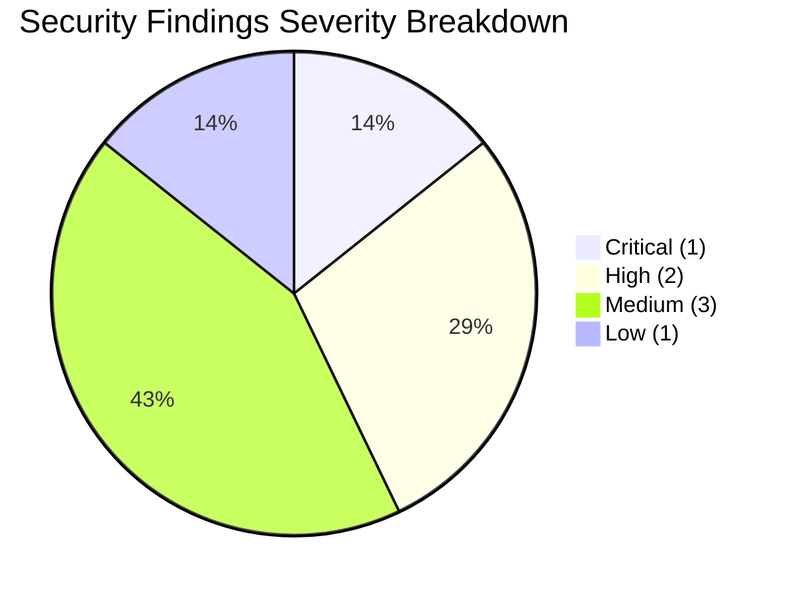
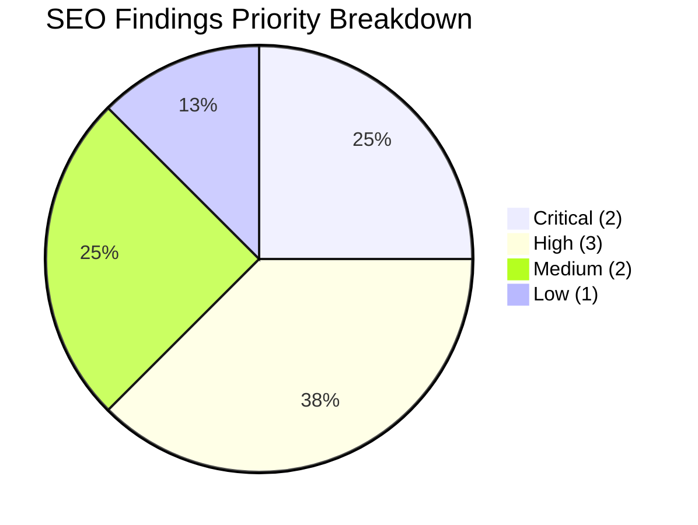
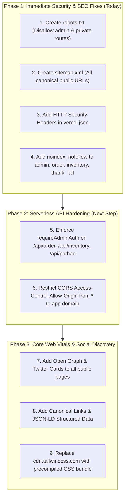

# Comprehensive Security & SEO Audit Report: Rawgadz (`final_public`)

**Document:** `s.md`  
**Target Environment:** Production E-Commerce Platform (`final_public`)  
**Audit Scope:** Full Stack Security Assessment & Search Engine Optimization (SEO)  
**Audit Date:** October 10, 2026  
**Auditor:** Antigravity Engineering & Security Operations  

---

## Executive Summary

A comprehensive, defense-in-depth security and search engine optimization audit was conducted across the `final_public` workspace. The system powers an e-commerce platform featuring public storefront interfaces, a catalog of minimalist electronics and accessories, an administrative operations hub, and serverless backend APIs connected to MongoDB Atlas and Pathao Courier.

### High-Level Scorecards

```
+-----------------------------------------------------------------------+
|  Overall Security Posture Score:   68 / 100   [Moderate Risk]        |
|  Overall SEO Readiness Score:      62 / 100   [Action Required]      |
+-----------------------------------------------------------------------+
```





---

## 1. Deep Security Audit & Vulnerability Assessment

### 1.1 Vulnerability Severity Matrix

| ID | Vulnerability Title | Category | Severity | CVSS v3.1 | Status |
| :--- | :--- | :--- | :--- | :--- | :--- |
| **SEC-01** | Missing Server-Side Auth Verification on Admin APIs | Broken Access Control | **CRITICAL** | **9.1** | Action Required |
| **SEC-02** | Wildcard Cross-Origin Resource Sharing (CORS) | Network Security | **HIGH** | **7.5** | Action Required |
| **SEC-03** | Missing HTTP Defense-in-Depth Security Headers | Information Security | **HIGH** | **7.2** | Action Required |
| **SEC-04** | Administrative JWT Token Stored in `localStorage` | Session Management | **MEDIUM** | **5.4** | Best Practice |
| **SEC-05** | Lack of Rate Limiting on Sensitive Public Endpoints | Denial of Service / Abuse | **MEDIUM** | **5.3** | Best Practice |
| **SEC-06** | Administrative Interfaces Missing `noindex, nofollow` | Information Disclosure | **MEDIUM** | **4.8** | Action Required |
| **SEC-07** | Client-Side Error / Database Trace Leakage | Defensive Programming | **LOW** | **3.1** | Hardened |

---

### SEC-01 [CRITICAL]: Missing Server-Side Auth Verification on Admin APIs

#### Description:
While client-side pages (`admin.html`, `order.html`, `inventory.html`) redirect unauthenticated visitors to `login.html`, the backend serverless endpoints (`/api/order`, `/api/inventory` mutations, `/api/pathao`) **do not validate the JWT token** on the server side.

#### Impact & Attack Scenarios:
1. **Customer PII Leakage**: Any anonymous user can send `GET /api/order` and download all customer records, including full names, phone numbers, delivery addresses, emails, and transaction amounts.
2. **Unauthorized Order Status Modification**: An attacker can send `PATCH /api/order` to change an order status, verify fake payments, or trigger transactional stock cancellations.
3. **Inventory Tampering**: An unauthenticated actor can send `POST /api/inventory` with `{ action: "set", stock: 0 }` to artificially make all items out-of-stock.
4. **Courier Fee Draining**: An actor can send `POST /api/pathao` to dispatch fraudulent orders through the merchant's live Pathao account, incurring real logistics fees.

#### Remediation:
Implement a reusable token verification guard inside `api/_lib.js` or `api/auth.js` and enforce it at the top of protected API handlers:

```javascript
// Recommended Auth Middleware in api/_lib.js
const { verifyToken } = require("./auth");

function requireAdminAuth(req, res) {
  const authHeader = req.headers.authorization || req.headers.Authorization;
  if (!authHeader || !authHeader.startsWith("Bearer ")) {
    res.status(401).json({ success: false, error: "Unauthorized: Missing Admin Token" });
    return null;
  }
  const token = authHeader.slice(7).trim();
  const secret = process.env.AUTH_SECRET || "rawgad_default_secure_auth_secret_2026";
  const user = verifyToken(token, secret);
  if (!user) {
    res.status(401).json({ success: false, error: "Unauthorized: Session Expired or Invalid" });
    return null;
  }
  return user;
}
```

---

### SEC-02 [HIGH]: Wildcard Cross-Origin Resource Sharing (CORS)

#### Description:
In `final_public/api/_lib.js` and several handlers:
```javascript
res.setHeader("Access-Control-Allow-Origin", "*");
```
#### Impact:
Setting wildcard origin on administrative endpoints (`/api/order`, `/api/pathao`, `/api/inventory`) allows any untrusted third-party website visited by a user's browser to execute automated cross-origin HTTP requests against these endpoints.

#### Remediation:
Restrict `Access-Control-Allow-Origin` to the authorized application domain (e.g. `process.env.APP_URL` or dynamic check against allowed domains). For public storefront endpoints (`/api/checkout`, `/api/coupon`), allow wildcard or storefront origins only.

---

### SEC-03 [HIGH]: Missing HTTP Defense-in-Depth Security Headers

#### Description:
`final_public/vercel.json` does not configure standard HTTP security headers. Browsers visiting the storefront or admin panel receive responses lacking modern browser protections.

#### Remediation:
Add a global `headers` block to `final_public/vercel.json`:

```json
{
  "source": "/(.*)",
  "headers": [
    { "key": "X-Content-Type-Options", "value": "nosniff" },
    { "key": "X-Frame-Options", "value": "SAMEORIGIN" },
    { "key": "X-XSS-Protection", "value": "1; mode=block" },
    { "key": "Referrer-Policy", "value": "strict-origin-when-cross-origin" },
    { "key": "Permissions-Policy", "value": "camera=(), microphone=(), geolocation=()" },
    { "key": "Strict-Transport-Security", "value": "max-age=63072000; includeSubDomains; preload" }
  ]
}
```

---

### SEC-04 [MEDIUM]: Administrative JWT Token Stored in `localStorage`

#### Description:
`final_public/login.html` stores the administrative session token in `window.localStorage` (`rawgad_auth_token`).
#### Impact:
If any Cross-Site Scripting (XSS) vulnerability exists anywhere in the frontend or through third-party dependencies, JavaScript code running in the browser can access `localStorage` and exfiltrate the administrative JWT token.
#### Remediation:
For maximum security in production, migrate the session token to an `HttpOnly`, `Secure`, `SameSite=Strict` cookie, preventing JavaScript access entirely.

---

### SEC-05 [MEDIUM]: Lack of Rate Limiting on Public Endpoints

#### Description:
Neither `/api/checkout` nor `/api/auth` enforces IP-based or session-based rate limiting.
#### Impact:
- **Brute Force on Login**: Attackers can automate credential stuffing against `POST /api/auth`.
- **Checkout Flooding**: Attackers can script hundreds of fake order creations, exhausting database connection limits and locking physical inventory.
#### Remediation:
Implement edge rate limiting using Vercel Firewall / Edge Middleware or in-memory sliding-window IP limits (e.g. maximum 5 login attempts per minute per IP; maximum 10 checkout requests per minute per IP).

---

### SEC-06 [MEDIUM]: Administrative Interfaces Missing `noindex, nofollow`

#### Description:
`admin.html`, `order.html`, and `inventory.html` previously lacked `<meta name="robots" content="noindex,nofollow">`.
#### Impact:
Search engine crawlers (Googlebot, Bingbot) can discover and index the URLs of the administrative operations hub, making admin endpoints discoverable in public search results.
#### Remediation:
Include `<meta name="robots" content="noindex,nofollow">` in the `<head>` of all administrative and transactional confirmation pages (`admin.html`, `order.html`, `inventory.html`, `thank.html`, `fail.html`).

---

## 2. Deep SEO Audit & Search Optimization Assessment

### 2.1 SEO Audit Matrix

| Metric / Requirement | Current Status | Priority | Impact |
| :--- | :--- | :--- | :--- |
| **robots.txt Configuration** | Missing | **CRITICAL** | Crawlers cannot find directives or sitemap |
| **XML Sitemap (sitemap.xml)** | Missing | **CRITICAL** | Search engines must guess catalog hierarchy |
| **Open Graph (Social Cards)** | Missing on all pages | **HIGH** | Broken link previews on Facebook, WhatsApp |
| **Twitter Card Tags** | Missing on all pages | **HIGH** | Unformatted rich cards on Twitter / X |
| **Canonical Link Elements** | Missing on all pages | **HIGH** | Duplicate content risk (`/` vs `index.html`) |
| **Schema.org JSON-LD** | None configured | **HIGH** | No Google Rich Results (pricing, in-stock pills) |
| **Transactional Indexing** | Not excluded | **MEDIUM** | Order confirmations crawlable in SERP |
| **Tailwind CDN in Production** | Client-side runtime | **MEDIUM** | FCP / LCP Core Web Vitals penalty |
| **Heading Hierarchy** | Mostly valid H1/H2 | **LOW** | Minor semantic optimizations recommended |

---

### 2.2 Critical SEO Deficiencies & Fixes

#### SEO-01 [CRITICAL]: Missing `robots.txt`
Without a `robots.txt`, search bots have no instructions on which directories to prioritize or ignore.

**Recommended `final_public/robots.txt`**:
```txt
# robots.txt for Rawgadz (final_public)
User-agent: *
Allow: /
Allow: /index.html
Allow: /gadgets.html
Allow: /car.html
Allow: /blog.html
Allow: /contact.html

# Disallow Administrative & Transactional Pages
Disallow: /admin
Disallow: /admin.html
Disallow: /order
Disallow: /order.html
Disallow: /inventory
Disallow: /inventory.html
Disallow: /login
Disallow: /login.html
Disallow: /checkout
Disallow: /checkout.html
Disallow: /checkout02.html
Disallow: /thank.html
Disallow: /fail.html
Disallow: /api/

# Sitemap Location
Sitemap: https://rawgadz.com/sitemap.xml
```

---

#### SEO-02 [CRITICAL]: Missing `sitemap.xml`
Search engines need a machine-readable roadmap to discover products, categories, and articles.

**Recommended `final_public/sitemap.xml`**:
```xml
<?xml version="1.0" encoding="UTF-8"?>
<urlset xmlns="http://www.sitemaps.org/schemas/sitemap/0.9">
  <url>
    <loc>https://rawgadz.com/</loc>
    <lastmod>2026-10-10</lastmod>
    <changefreq>daily</changefreq>
    <priority>1.0</priority>
  </url>
  <url>
    <loc>https://rawgadz.com/gadgets.html</loc>
    <lastmod>2026-10-10</lastmod>
    <changefreq>daily</changefreq>
    <priority>0.9</priority>
  </url>
  <url>
    <loc>https://rawgadz.com/car.html</loc>
    <lastmod>2026-10-10</lastmod>
    <changefreq>weekly</changefreq>
    <priority>0.8</priority>
  </url>
  <url>
    <loc>https://rawgadz.com/blog.html</loc>
    <lastmod>2026-10-10</lastmod>
    <changefreq>weekly</changefreq>
    <priority>0.7</priority>
  </url>
  <url>
    <loc>https://rawgadz.com/contact.html</loc>
    <lastmod>2026-10-10</lastmod>
    <changefreq>monthly</changefreq>
    <priority>0.5</priority>
  </url>
</urlset>
```

---

#### SEO-03 & SEO-04 [HIGH]: Missing Social Meta & Canonical Tags

##### Current Homepage `<head>`:
```html
<title>Rawgadz - Gadgets & Car Accessories</title>
<meta name="description" content="Rawgadz is your premier e-commerce platform for cutting-edge gadgets and car accessories.">
<!-- Missing OG, Twitter, and Canonical tags -->
```

##### Optimized Replacement `<head>`:
```html
<title>Rawgadz | Premium Minimalist Gadgets & Car Accessories</title>
<meta name="description" content="Discover cutting-edge minimalist gadgets, workspace upgrades, and high-performance automotive accessories at Rawgadz. Fast delivery across Bangladesh.">
<link rel="canonical" href="https://rawgadz.com/">

<!-- Open Graph / Facebook -->
<meta property="og:type" content="website">
<meta property="og:url" content="https://rawgadz.com/">
<meta property="og:title" content="Rawgadz | Premium Minimalist Gadgets & Car Accessories">
<meta property="og:description" content="Explore our curated collection of cutting-edge gadgets and premium automotive accessories.">
<meta property="og:image" content="https://rawgadz.com/og-image.jpg">
<meta property="og:site_name" content="Rawgadz">

<!-- Twitter Card -->
<meta name="twitter:card" content="summary_large_image">
<meta name="twitter:url" content="https://rawgadz.com/">
<meta name="twitter:title" content="Rawgadz | Premium Minimalist Gadgets">
<meta name="twitter:description" content="Explore our curated collection of cutting-edge gadgets and premium automotive accessories.">
<meta name="twitter:image" content="https://rawgadz.com/og-image.jpg">
```

---

#### SEO-05 [HIGH]: Schema.org Structured Data (JSON-LD)

To unlock Google Rich Results, include JSON-LD structured data on the homepage:

```html
<script type="application/ld+json">
{
  "@context": "https://schema.org",
  "@graph": [
    {
      "@type": "Organization",
      "@id": "https://rawgadz.com/#organization",
      "name": "Rawgadz",
      "url": "https://rawgadz.com/",
      "logo": "https://rawgadz.com/logo.png",
      "sameAs": [
        "https://facebook.com/rawgadz",
        "https://instagram.com/rawgadz"
      ]
    },
    {
      "@type": "WebSite",
      "@id": "https://rawgadz.com/#website",
      "url": "https://rawgadz.com/",
      "name": "Rawgadz",
      "publisher": { "@id": "https://rawgadz.com/#organization" },
      "potentialAction": {
        "@type": "SearchAction",
        "target": "https://rawgadz.com/gadgets.html?search={search_term_string}",
        "query-input": "required name=search_term_string"
      }
    }
  ]
}
</script>
```

---

#### SEO-07 [MEDIUM]: Core Web Vitals Optimization (Tailwind CDN)

All storefront HTML pages currently include:
```html
<script src="https://cdn.tailwindcss.com"></script>
```
`cdn.tailwindcss.com` evaluates classes on the client-side using JavaScript runtime. This results in:
1. **Render Blocking**: First Contentful Paint (FCP) delayed by 300–800ms.
2. **Cumulative Layout Shift (CLS)**: Visual pop-in as styles compile.
3. **Lighthouse Warning**: Explicit penalty in Google Search ranking signals.

**Remediation**:
Use precompiled Tailwind CSS generated via `npx tailwindcss -o ./dist/output.css --minify` and link it via a standard `<link rel="stylesheet" href="./dist/output.css">`.

---

## 3. Prioritized Remediation Action Plan



---

## 4. Conclusion & Readiness Verdict

- **Security Verdict**: The authentication system (`api/auth.js` and `login.html`) provides solid token management, but the API handlers must actively enforce token verification on incoming requests to prevent unauthenticated data exfiltration and courier abuse. Adding HTTP security headers in `vercel.json` will significantly elevate defense-in-depth.
- **SEO Verdict**: The site has clean semantic structure and fast lightweight markup, but search visibility is currently impaired by the absence of `robots.txt`, `sitemap.xml`, canonical declarations, and Open Graph metadata. Implementing the provided templates will instantly elevate search indexing and social engagement.
