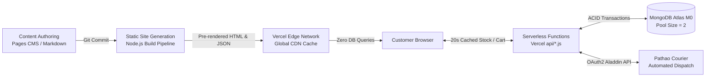
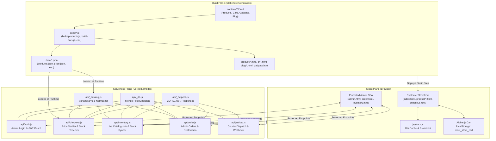
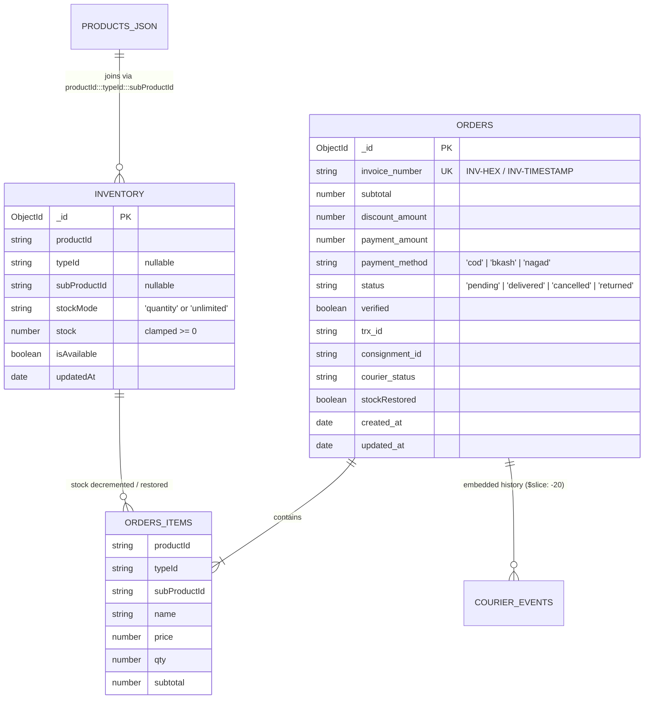
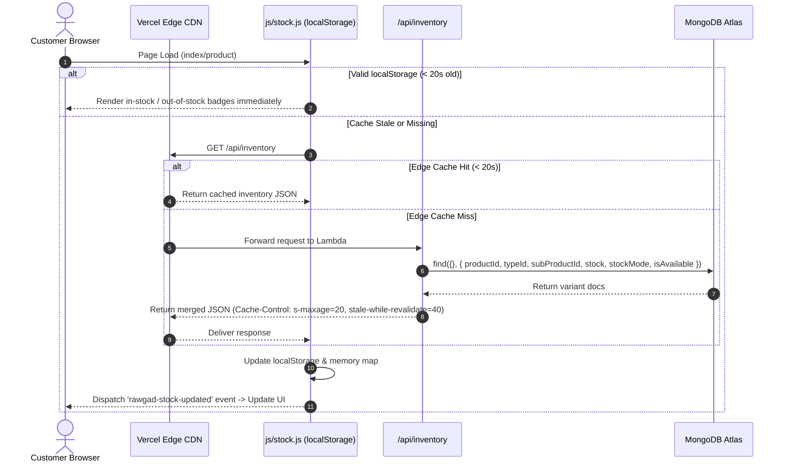
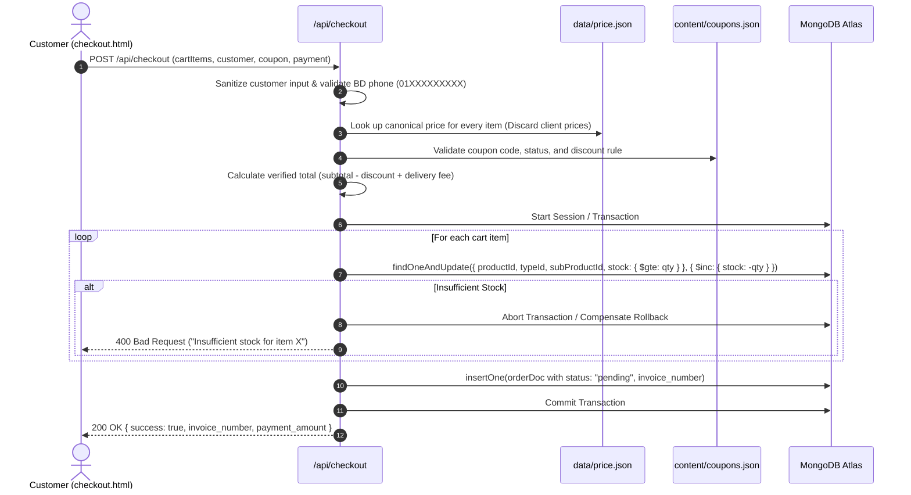
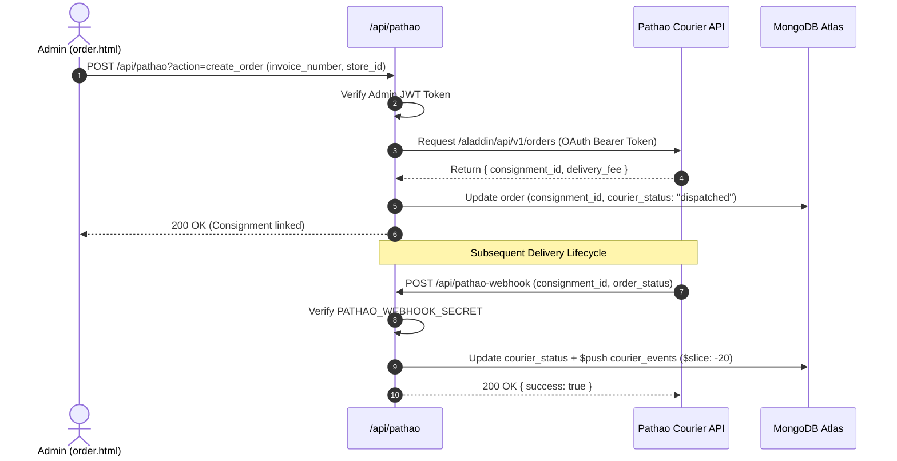
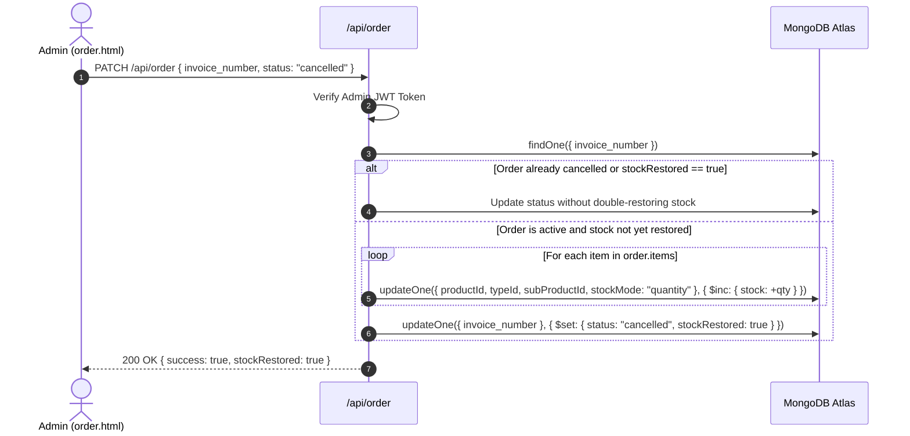

# System Architecture Report: Rawgadz Platform

**Project:** Rawgadz E-Commerce & Automotive Platform  
**Target Environment:** Vercel Serverless Functions + Vercel Edge CDN + MongoDB Atlas (M0 Tier) + Pathao Courier Aladdin API  
**Architectural Style:** Jamstack Static Site Generation (SSG) with Modular Serverless Backend Micro-APIs  
**Report Date:** November 2026  

---

## 1. Executive Summary & Core Architectural Principles

**Rawgadz** is an e-commerce platform specialized for automotive accessories and lifestyle gadgets in Bangladesh. The system operates on a **Jamstack SSG + Serverless Hybrid** architectural paradigm:

### Core Architectural Principles

1. **Zero-Hydration Static Browsing**: Product showcases, automotive guides, and blogs are pre-rendered into static HTML during build time. Catalog browsing requires 0 database queries, providing sub-100ms Time-to-First-Byte (TTFB) directly via the Edge CDN.
2. **Git-Backed Headless CMS**: Marketing and content teams publish updates via [Pages CMS](https://pagescms.org) through `.pages.yml`. Commits trigger deterministic Node.js compilation scripts (`build/*.js`).
3. **2-Mode Variant Stock Architecture**: Supports both finite tracked inventory (`quantity` mode with real-time atomic decrements) and print-on-demand/supplier-backed products (`unlimited` mode with availability flags).
4. **Authoritative Server-Side Validation**: All client price submissions are strictly discarded. Order totals and discounts are recalculated server-side against immutable build artifacts (`data/price.json` and `content/coupons.json`).
5. **MongoDB M0 Free-Tier Protection**: Throttled connection pool (`maxPoolSize: 2`), short idle timeouts (15s), and capped audit arrays (`$slice: -20`) to guarantee high uptime within 512MB RAM and 500-connection limits.
6. **Localized Fulfillment Engine**: Integrated with Pathao Courier Aladdin API and dynamic Bangladeshi administrative division address resolution (`js/bd-locations.js`).

---

## 2. Technology Stack & Runtime Matrix

| Subsystem | Technology | Purpose / Configuration |
|---|---|---|
| **Runtime & Language** | Node.js (CommonJS) | Serverless handlers and SSG build scripts |
| **Hosting & CDN** | Vercel Serverless & Edge Network | Static asset hosting, routing, headers (`vercel.json`) |
| **Database** | MongoDB Atlas (M0 Free Tier) | Official driver `mongodb: ^6.3.0`, connection singleton |
| **Content Management** | Pages CMS | Git-backed Markdown schema authored via `.pages.yml` |
| **SSG Compilers** | `gray-matter`, `marked`, custom Node.js | Compiles `content/**/*.md` into `data/*.json` and static HTML |
| **Frontend Framework** | Vanilla HTML5 + Tailwind CSS + Alpine.js v3 | Reactive client stores (`$store.cart`, `$store.inventory`) |
| **Client Utilities** | `stock.js`, `bd-locations.js`, `hero-slider.js` | 20s localStorage cache, BD address mapping, banner slider |
| **Logistics / Courier** | Pathao Courier Aladdin REST API | OAuth2 password grant token exchange, automated shipping |
| **Authentication** | HMAC-SHA256 JWT-like Token | Custom stateless token issuing with constant-time verification |

---

## 3. System Context & Component Architecture

### 3.1 Architectural Decomposition

The application divides into three primary planes:

### 3.2 Key Serverless API Modules (`api/`)

1. **`api/_db.js` (Database Singleton & Pool Control)**:
   - Provides `getDb()`, `getInventoryCollection()`, and `getOrdersCollection()`.
   - Reuses connections via `global._mongoClient` across warm serverless invocations.
   - Throttles connection pool to `maxPoolSize: 2` with `maxIdleTimeMS: 15000` to prevent Atlas M0 tier pool exhaustion.
2. **`api/_helpers.js` (Security, Token & Middleware Utilities)**:
   - Stateless HS256 token generation and verification using `crypto.createHmac`.
   - Token extraction from `Authorization: Bearer`, `X-Admin-Token`, `X-Auth-Token`, or `?token=` parameters.
   - Strict `requireAdminAuth(req, res)` gatekeeper.
3. **`api/_catalog.js` (Catalog Normalization & Canonical Variant Mapping)**:
   - Canonical compound variant key:
     $$\text{Key} = \text{productId} + \text{":::"} + \text{typeId} + \text{":::"} + \text{subProductId}$$
   - Maps raw `data/products.json` into flattened purchasable variant definitions with standardized pricing and stock status indicators.
4. **`api/checkout.js` (Anti-Tamper Order Processing)**:
   - Strict price re-calculation using server-side `data/price.json`.
   - Coupon verification against `content/coupons.json`.
   - Two-phase stock decrement: uses MongoDB sessions/transactions where supported, with automatic non-replica compensation rollback fallback.
5. **`api/inventory.js` (Live Stock Resolution & Catalog Merging)**:
   - Joins static `data/products.json` with dynamic MongoDB `inventory` documents.
   - Public GET with Edge CDN caching (`s-maxage=20, stale-while-revalidate=40`).
   - Protected admin stock mutations (`PUT`/`PATCH`) and live catalog synchronization (`POST ?action=sync`).
6. **`api/order.js` (Order Management & Aggregation)**:
   - Protected order retrieval with MongoDB `$facet` aggregation pipeline (revenue, pending dispatch, pending payment).
   - Order status mutations with **automated stock restoration** for cancelled/returned orders.
7. **`api/pathao.js` (Courier Dispatch & Webhook Management)**:
   - Pathao Aladdin OAuth token exchange with memory caching.
   - Order consignment generation and tracking ID persistence.
   - Webhook endpoint verified with `PATHAO_WEBHOOK_SECRET`, updating delivery statuses with capped history array (`$slice: -20`).

---

## 4. Data Architecture & Canonical Schema Specifications

### 4.1 Canonical Compound Variant Keys
A product variant in Rawgadz is identified using a 3-tier canonical string key:
- Simple Product: `prod_001:::_:::_`
- 1-Level Option: `prod_001:::type_leather:::_`
- 2-Level Nested Variant: `prod_001:::type_leather:::sub_red_stitch`

Any `null`, `undefined`, empty string, or `"null"` value is normalized to `_`.

### 4.2 MongoDB Collections & Indexes
1. **`inventory` Collection**:
   - Compound Unique Index: `{ productId: 1, typeId: 1, subProductId: 1 }` (guarantees idempotency and prevent duplicate records per variant).
   - Stock Model:
     - `stockMode: "quantity"`: Relies on `stock: Number`. In-stock if `stock > 0`.
     - `stockMode: "unlimited"`: Relies on `isAvailable: Boolean`. In-stock if `isAvailable === true`.
2. **`orders` Collection**:
   - Unique Index: `{ invoice_number: 1 }`
   - Secondary Index: `{ created_at: -1 }` (for admin pagination and fast chronological sorting)
   - Embedded line items explicitly record `productId`, `typeId`, `subProductId`, `qty`, and calculated `subtotal`.

---

## 5. End-to-End Data Flows

### 5.1 Storefront Browsing & 20-Second Edge Stock Cache

### 5.2 Anti-Tamper Order Placement Flow

### 5.3 Automated Courier Dispatch & Webhook Delivery Cycle

### 5.4 Order Cancellation & Variant Stock Restoration

---

## 6. Security & Reliability Architecture

### 6.1 Authentication & Authorization
- **Stateless Admin Token**: Issues an HMAC-SHA256 JWT-like bearer token valid for 7 days upon verifying `ADMIN_EMAIL` and `ADMIN_PASSWORD`.
- **Strict Role Enforcement**: Public users have zero access to administrative mutations. All mutating operations in `/api/order`, `/api/inventory` (sync/update), and `/api/pathao` strictly check `requireAdminAuth()`.
- **Zero In-Repo Credentials**: All production keys (`AUTH_SECRET`, `MONGO_URI`, `PATHAO_CLIENT_SECRET`) reside in environment variables.

### 6.2 Anti-Tamper & Financial Integrity
- **Server-Side Price Authority**: Rawgadz protects against cart tampering by pulling prices directly from `data/price.json`. Even if a client alters localStorage or intercepts HTTP payloads, the checkout server computes the final bill.
- **Stock Lock Consistency**: Uses MongoDB conditional updates `{ stock: { $gte: item.qty } }` with `$inc: { stock: -item.qty }`, preventing overselling in race conditions.

### 6.3 Resource Quota Defense (MongoDB Free M0 Tier)
- **Bounded Audit History**: Webhook event logs pushed to orders are capped using MongoDB's `$slice: -20` operator. This prevents single high-churn orders from exceeding the 16MB document limit and protects Atlas's 512MB storage cap.
- **Strict Connection Pool Limits**: Set to `maxPoolSize: 2` with short idle timeouts (15s). During high concurrent traffic, Vercel Serverless spin-ups will not overwhelm the MongoDB connection limit (500 maximum connections).

---

## 7. Architectural Strengths, Trade-Offs & Evolution Roadmap

### 7.1 Key Strengths
- **Instant Storefront TTFB**: Static generation ensures customers experience zero lag browsing products and categories.
- **Cost Efficiency**: Runs completely within zero-cost free tiers (Vercel Hobby + MongoDB M0 Free Tier).
- **Graceful Offline Degradation**: The frontend stock client falls back to stale `localStorage` if network connectivity drops, avoiding broken layouts.

### 7.2 Trade-Offs & Mitigation
1. **Build-Time vs. Live Pricing**: Changing prices requires a Git commit or triggering an SSG build.  
   *Mitigation:* Prices in this market are relatively stable; for dynamic flash sales, a database-level price override collection can be introduced.
2. **Single Admin User**: Only one administrative credential set is supported via environment variables.  
   *Mitigation:* Multi-user RBAC can be introduced with a dedicated `users` collection when team scale requires distinct roles.
3. **Webhook Verification Delivery Guarantee**: Webhooks update orders directly; transient database downtimes could lead to missed events.  
   *Mitigation:* Admin dashboard features manual "Sync Tracking" button that polls Pathao directly.

---

## 8. Directory & File Reference

- **Serverless API**:
  - [`api/_db.js`](file:///C:/Users/victus/Documents/rawgadz_backup/rawgadz_final/api/_db.js): MongoDB connection pooling & singleton
  - [`api/_helpers.js`](file:///C:/Users/victus/Documents/rawgadz_backup/rawgadz_final/api/_helpers.js): CORS, JWT validation & HTTP helpers
  - [`api/_catalog.js`](file:///C:/Users/victus/Documents/rawgadz_backup/rawgadz_final/api/_catalog.js): Variant mapping & stock calculations
  - [`api/checkout.js`](file:///C:/Users/victus/Documents/rawgadz_backup/rawgadz_final/api/checkout.js): Checkout & atomic stock reservation
  - [`api/inventory.js`](file:///C:/Users/victus/Documents/rawgadz_backup/rawgadz_final/api/inventory.js): Live inventory queries & catalog sync
  - [`api/order.js`](file:///C:/Users/victus/Documents/rawgadz_backup/rawgadz_final/api/order.js): Admin order management & stock restoration
  - [`api/pathao.js`](file:///C:/Users/victus/Documents/rawgadz_backup/rawgadz_final/api/pathao.js): Pathao Aladdin integration & webhooks
- **Frontend Core**:
  - [`js/stock.js`](file:///C:/Users/victus/Documents/rawgadz_backup/rawgadz_final/js/stock.js): 20s stock cache manager
  - [`js/bd-locations.js`](file:///C:/Users/victus/Documents/rawgadz_backup/rawgadz_final/js/bd-locations.js): Bangladesh administrative division directory
  - [`checkout.html`](file:///C:/Users/victus/Documents/rawgadz_backup/rawgadz_final/checkout.html): Multi-step checkout SPA
  - [`order.html`](file:///C:/Users/victus/Documents/rawgadz_backup/rawgadz_final/order.html): Admin order management dashboard
  - [`inventory.html`](file:///C:/Users/victus/Documents/rawgadz_backup/rawgadz_final/inventory.html): Admin inventory management console
- **Build & Static Assets**:
  - [`package.json`](file:///C:/Users/victus/Documents/rawgadz_backup/rawgadz_final/package.json): Build scripts & dependencies
  - [`vercel.json`](file:///C:/Users/victus/Documents/rawgadz_backup/rawgadz_final/vercel.json): Routing rules, rewrites, and Edge CDN cache headers
  - [`.pages.yml`](file:///C:/Users/victus/Documents/rawgadz_backup/rawgadz_final/.pages.yml): Pages CMS collection schemas
